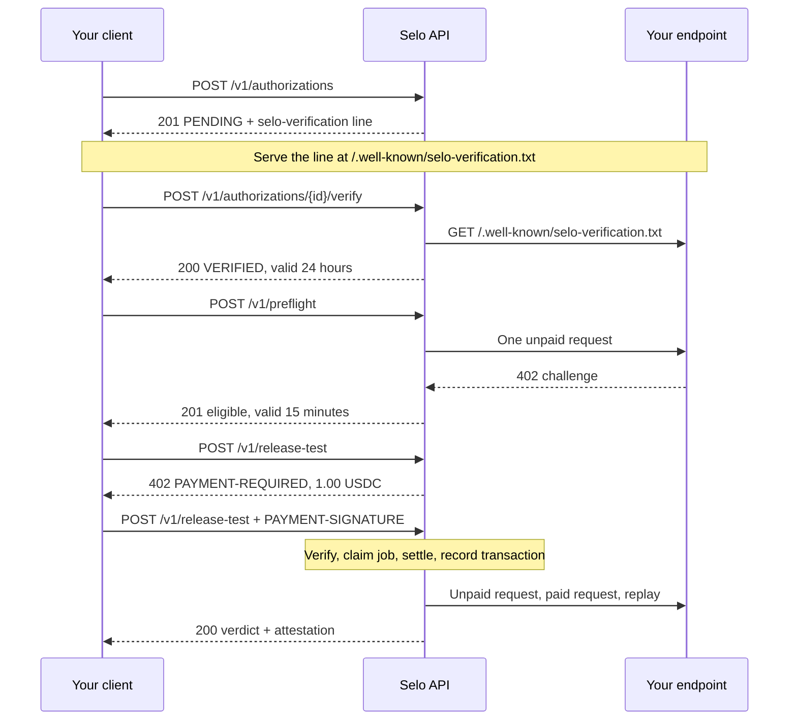

The Selo API is a small JSON API at `https://api.useselo.xyz`. Four calls take you from an endpoint you own to a signed release verdict, and only one of them costs money: `POST /v1/release-test`, paid over x402.

## Base URL

```text Base URL
https://api.useselo.xyz
```

The public deployment runs on Algorand Mainnet. It is paid, and pays your endpoint, in USDC (ASA `31566704`) on the network `algorand:wGHE2Pwdvd7S12BL5FaOP20EGYesN73ktiC1qzkkit8=`, settled through the GoPlausible facilitator (`https://facilitator.goplausible.xyz`).

## Endpoints

| Method | Path | Cost | Purpose |
| --- | --- | --- | --- |
| `POST` | `/v1/authorizations` | Free | Request a verification token for one origin, path and method |
| `POST` | `/v1/authorizations/{authorizationId}/verify` | Free | Selo fetches your well-known file and verifies the token |
| `GET` | `/v1/authorizations/{authorizationId}` | Free | Read an authorization |
| `POST` | `/v1/preflight` | Free | Check that the target is testable and within budget |
| `GET` | `/v1/preflight/{preflightId}` | Free | Read a stored preflight |
| `POST` | `/v1/release-test` | 1.00 USDC over x402 | Run the release test and get the verdict |
| `GET` | `/v1/reports/{token}` | Free | Read the private report |
| `GET` | `/.well-known/selo-attestation-keys.json` | Free | Public keys that verify signed verdicts |
| `GET` | `/llms.txt` | Free | Plain-text description for agents |
| `GET` | `/.well-known/agent-card.json` | Free | Agent card |
| `GET` | `/` | Free | Minimal HTML homepage |
| `GET` | `/health` | Free | Liveness |

Each endpoint has its own reference page, generated from the OpenAPI document, in this section.

## Authentication

There are no API keys, accounts or bearer tokens. Three things stand in for them:

- **Authorization, per target.** Before Selo sends your endpoint anything, you prove you control it by serving a token at `/.well-known/selo-verification.txt` on its origin. A verified authorization covers exactly one origin, path and method for 24 hours. See [Authorization](/concepts/authorization) and [Authorize your endpoint](/guides/authorize-endpoint).
- **Payment, per call.** The only paid route is `POST /v1/release-test`. The x402 payment in the `PAYMENT-SIGNATURE` header is what admits the request.
- **The report token.** The private report is addressed by an unguessable token in `reportUrl`. Whoever holds the link can read the report.

## Requests and responses

- Send request bodies as JSON with `Content-Type: application/json`. Responses are JSON, except `/llms.txt` (`text/plain`) and `/` (`text/html`).
- Every request body is limited to 64 KiB (65536 bytes). A larger body gets `413` with `PAYLOAD_TOO_LARGE`.
- Bodies are strict. An unknown field, a missing field or a body that is not JSON gets `400` with `VALIDATION_FAILED`.
- IDs are a prefix plus 26 Crockford base32 characters: `auth_` (authorization), `pfl_` (preflight), `job_` (release job), `evd_` (evidence record). A malformed ID in a path gets `404`.
- USDC amounts in Selo's own bodies are decimal strings with 2 to 6 decimals, such as `"1.00"` or `"0.01"`. Inside x402 headers, amounts are atomic units: `"1000000"` is 1.00 USDC.
- Timestamps are ISO 8601 in UTC, for example `2026-10-26T10:24:12.218Z`.
- Errors share one body, `{ "error": "<CODE>", "message": "<text>" }`. The full list is in [Errors and reason codes](/api-reference/errors).

## Call sequence



<Steps>
  <Step title="Create an authorization">
    `POST /v1/authorizations` with the target URL, method, a project name and a contact. You get an `auth_…` ID and the exact `selo-verification=…` line to publish. The challenge stays open for one hour.
  </Step>
  <Step title="Publish the token and verify">
    Serve the line in `https://<your origin>/.well-known/selo-verification.txt`, then call `POST /v1/authorizations/{authorizationId}/verify`. The authorization becomes `VERIFIED` for 24 hours.
  </Step>
  <Step title="Run a preflight">
    `POST /v1/preflight` with the authorization, the target URL, the method and, for `POST`, the request body. Selo sends your endpoint one unpaid request and checks its 402 challenge. An eligible preflight returns a `pfl_…` ID valid for 15 minutes. See [Run a preflight](/guides/preflight).
  </Step>
  <Step title="Pay and run the release test">
    `POST /v1/release-test` with the preflight ID, `"profile": "quick"` and, optionally, a release contract and a release ID. Answer the 402 with an x402 payment. The response carries the verdict, the five checks, both payment legs and a signed attestation. See [Run a release test](/guides/run-release-test).
  </Step>
  <Step title="Read the report and verify the verdict">
    Fetch `reportUrl` for the full report. Verify `attestation` against the keys at `/.well-known/selo-attestation-keys.json`. See [Verify a signed verdict](/guides/verify-attestation).
  </Step>
</Steps>

The `selo` CLI and the GitHub Action run this sequence for you. See [CLI overview](/cli/overview) and [Gate deploys in GitHub Actions](/guides/github-actions).

## The paid route and x402

`POST /v1/release-test` follows x402 version 2. Selo uses three headers:

| Header | Direction | Content |
| --- | --- | --- |
| `PAYMENT-REQUIRED` | Response, `402` | Base64-encoded JSON challenge: what to pay, to whom, on which network |
| `PAYMENT-SIGNATURE` | Request | Base64-encoded JSON payment payload that pays one offered requirement |
| `PAYMENT-RESPONSE` | Response | Base64-encoded JSON settlement result, with the transaction ID |

The x402 version 1 header `X-PAYMENT` is not read.

<Steps>
  <Step title="Ask for the price">
    Send the release test request without `PAYMENT-SIGNATURE`. Selo first validates the body, the `Idempotency-Key` header and the preflight: it must exist, be eligible and unexpired, its authorization must still be verified, and the target's price must be within the per-job limit. Any problem is reported as an error before Selo asks for money. Otherwise the answer is `402` with an empty JSON body (`{}`), `Cache-Control: no-store` and a `PAYMENT-REQUIRED` header.
  </Step>
  <Step title="Pay">
    Sign the offered requirement with an x402 v2 client and send the identical request again with `PAYMENT-SIGNATURE`. Keep the same body and the same `Idempotency-Key`.
  </Step>
  <Step title="Wait for the verdict">
    Selo verifies the payment with the facilitator, claims the job, settles the payment and records the settlement transaction on the job. Only after that does it pay your endpoint and run the checks. The response arrives when the job finishes. A job has a 60-second wall clock, so set your client timeout well above 60 seconds.
  </Step>
</Steps>

The decoded `PAYMENT-REQUIRED` challenge of the live route, captured on Mainnet, offers exactly one requirement:

```json accepts[0]
{
  "scheme": "exact",
  "network": "algorand:wGHE2Pwdvd7S12BL5FaOP20EGYesN73ktiC1qzkkit8=",
  "amount": "1000000",
  "asset": "31566704",
  "payTo": "N37HMJCB4BAITC2ZU7C4XW7PUMCO4T3TUASHQEL6A4EWMLOTTHOB7IOOKY",
  "maxTimeoutSeconds": 300,
  "extra": {
    "name": "USDC",
    "decimals": 6,
    "tag": "x402-global-challenge",
    "feePayer": "ZMFK2OI7ZBD2U27ISERZC4S6LKM6WMFJPZQ4MYNJDZ2VNBNMBA67RA22AA"
  }
}
```

The challenge also carries `resource` (URL, description, `tags: ["x402-global-challenge"]`) and `extensions` with Bazaar discovery metadata. When a payment is refused at verification, the `402` repeats the challenge and its `error` field says why.

| Outcome | Status | What it means |
| --- | --- | --- |
| Settled and tested | `200` | The body is the release test response. `PAYMENT-RESPONSE` carries your settlement transaction. |
| Payment missing or refused | `402` | Nothing was settled. Read `PAYMENT-REQUIRED`. |
| Settlement definitely failed | `402` | `PAYMENT-RESPONSE` has `success: false`. No job remains. |
| Facilitator unreachable at verification | `502` `FACILITATOR_UNAVAILABLE` | Nothing was charged. |
| Settlement outcome unknown | `502` `INBOUND_SETTLEMENT_UNRESOLVED` | The job is held for reconciliation and does not run. Do not pay again for this request. |

You can pay with any x402 v2 client that supports Algorand. See [Pay with any x402 client](/guides/any-x402-client) and [Payments and spend limits](/concepts/payments).

## Idempotency

Send an `Idempotency-Key` header on the paid request: 8 to 128 characters of `A-Z`, `a-z`, `0-9`, `_` or `-`. A malformed key gets `400` with `VALIDATION_FAILED`.

- The key is scoped to the `preflightId`. A repeat with the same preflight and key maps to the first job and never settles a second payment, even if it carries a newly signed payment.
- Without the header, Selo deduplicates on the signed payment itself: resending the identical `PAYMENT-SIGNATURE` maps to the same job.
- A settlement transaction that already belongs to a job maps to that job.

What a repeat returns depends on the first job:

| First job | Repeat gets |
| --- | --- |
| Finished with a report | `200` with the same response, including the same signed attestation |
| Still running | `409` `JOB_IN_PROGRESS`; retry shortly |
| Settlement outcome unknown | `502` `INBOUND_SETTLEMENT_UNRESOLVED` |
| Ended without a report | `409` `JOB_TERMINAL`; start a new preflight to retest |

<Warning>
If a paid request times out on your side, resend it with the same `preflightId` and the same `Idempotency-Key`. A new preflight is a new logical request and pays again. The CLI does this for you with `--resume`; see [Recover an interrupted run](/guides/resume).
</Warning>

## Release contract

The optional `expected` object in the paid request is your release contract: the HTTP status (default `200`), the media type and a JSON Schema the paid response must satisfy. An invalid contract gets `400` before Selo asks for payment. See [Write a release contract](/guides/release-contract).

The optional `deploymentId` (1 to 128 characters of `A-Z`, `a-z`, `0-9`, `.`, `_` or `-`) names your release. Selo records it and signs it into the attestation as `asserted_by_client`; it does not verify it.

## CORS

The API sends no CORS headers, so browser scripts on other origins cannot read its responses. Call it from a server, the CLI or a CI job.

## Report privacy

`reportUrl` has the form `https://api.useselo.xyz/v1/reports/<token>`, with a 43-character token. The token is the only credential, so keep the link out of public logs. The CLI redacts it in the summaries it writes; see [Output files](/cli/files).

Every response from the report route, including `404`, carries:

| Header | Value |
| --- | --- |
| `X-Robots-Tag` | `noindex, nofollow` |
| `Cache-Control` | `private, no-store` |
| `Referrer-Policy` | `no-referrer` |

A report exists once the job has finished and written it. An unknown token, a malformed token and an unfinished job all get the same `404` with `NOT_FOUND`.

## Discovery files

| Path | Type | Content |
| --- | --- | --- |
| `/llms.txt` | `text/plain` | Selo in one paragraph and its four main endpoints |
| `/.well-known/agent-card.json` | `application/json` | Agent card with one skill, `x402-release-test` |
| `/.well-known/selo-attestation-keys.json` | `application/json` | Ed25519 public keys for attestations, sent with `Cache-Control: public, max-age=300` |
| `/` | `text/html` | Name, tagline and the paid route |

The `402` challenge of `POST /v1/release-test` is itself machine-readable: `extensions.bazaar` declares the input example and schema and an output example, and `extensions.x402-merchant` names the service. Selo's paid route is listed in the GoPlausible Bazaar catalog. See [Use Selo from a coding agent](/agents).

## Health

`GET /health` returns `200` with `{"status":"ok"}` when the API can query its database. Any failure returns `500` with `INTERNAL`.

## Limits

| Limit | Value |
| --- | --- |
| Price of one release test | 1.00 USDC |
| Most Selo pays the target per job | 0.50 USDC |
| Absolute spend cap per job | 5.00 USDC |
| Pending verification challenge | 1 hour |
| Verified authorization | 24 hours |
| Eligible preflight | 15 minutes |
| Job wall clock | 60 seconds |
| Request body | 64 KiB |
| Preflight `requestBody` | 16 KiB, `POST` only |
| Release contract `jsonSchema` | 16 KiB |
| Verification file | 4096 bytes, 10-second timeout |

See [Pricing and limits](/resources/pricing-and-limits) for the full list.
