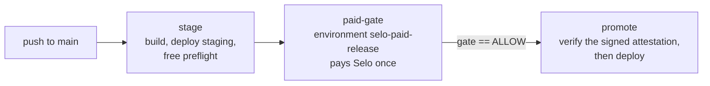

The Selo release gate is a composite GitHub Action at `.github/actions/release-gate` in the Selo repository. It runs the [`selo` CLI](/cli/overview) in one of three modes: a free `preflight`, a paid `test` that fails the step unless every release check passed with evidence, and an offline `verify` of a signed attestation.

```yaml
- uses: Enoch208/selo/.github/actions/release-gate@<reviewed commit sha>
  with:
    mode: preflight | test | verify
    url: https://staging.example.com/v1/orders
    method: POST
```

<Info>
For a guided setup, see [Gate deploys in GitHub Actions](/guides/github-actions). This page is the reference.
</Info>

## Modes

| Mode | Pays | Needs a wallet | Runs | Step fails when |
| --- | --- | --- | --- | --- |
| `preflight` | No | No | `selo preflight` | The preflight is not eligible (exit `3`) or Selo is unavailable (exit `2`) |
| `test` | Yes, once | `SELO_PAYER_MNEMONIC` in the step's `env` | `selo test` | Anything but a fully evidenced PASS (exit `1`, `2` or `3`) |
| `verify` | No | No | `selo verify` | The attestation does not verify, or attests anything but PASS |

Any other `mode` fails the step with exit `3` and the annotation `mode must be preflight, test or verify`.

### preflight

Runs `selo preflight` with `api`, `authorization`, `url`, `method` and, when set, `body`. It checks authorization, terms and eligibility, and spends nothing.

| Exit | `gate` | `verdict` |
| --- | --- | --- |
| `0` | `ELIGIBLE` | `none` |
| `2` or `3` | `BLOCK` | `none` |

### test

1. Deletes any existing `summary` and `attestation` files, so a stale file can never stand in for this run.
2. Runs `selo test` with `api`, `authorization`, `url`, `method`, `body` (when set), `contract`, `release`, `network`, `max-usdc`, `summary` and `attestation`. It adds `--pay-to` when `pay-to` is set, and `--approve-mainnet` when `approve-mainnet` is exactly `true`.
3. Reads `gate` and `verdict` from the summary file. If no summary was written, `gate` is `BLOCK` and `verdict` is `none`.
4. If the CLI exited `0` but the summary does not say `ALLOW`, it blocks with exit `2` and the error annotation `selo exited 0 without an ALLOW summary; blocking`.
5. If the CLI exited `2`, it adds the warning annotation: `The release test is not confirmed. Do not re-run this job until you have checked the earlier payment; a re-run starts a new paid test.`
6. Sets the outputs and exits with the CLI's code.

Because `GITHUB_STEP_SUMMARY` is set in every step, the run's summary page shows the verdict, each check, the job id and both transaction ids. See [GitHub step summary](/cli/files#github-step-summary).

### verify

Runs `selo verify` with `attestation`, `keys`, `release`, `url` and `method`.

| Exit | `gate` | `verdict` |
| --- | --- | --- |
| `0` | `ALLOW` | `PASS` |
| `1` | `BLOCK` | `FAIL` |
| `2` | `BLOCK` | `none` |
| `3` | `BLOCK` | `none` |

In `verify` mode, an attested INCONCLUSIVE and an attestation that cannot be verified both exit `2`, so `verdict` is `none` for both.

## Inputs

| Input | Required | Default | Modes | Description |
| --- | --- | --- | --- | --- |
| `mode` | Yes | | all | `preflight`, `test` or `verify`. |
| `api` | No | `https://api.useselo.xyz` | `preflight`, `test` | Selo API base URL. |
| `authorization` | No | `""` | `preflight`, `test` | A verified authorization id (`auth_…`) that covers the target route and method. Required by the CLI in these modes. |
| `url` | Yes | | all | The `https` URL of the paid x402 endpoint. |
| `method` | Yes | | all | `GET` or `POST`. |
| `body` | No | `""` | `preflight`, `test` | Path to a JSON request body file, `POST` only. |
| `contract` | No | `""` | `test` | Path to the release contract JSON. Required by the CLI in `test` mode. |
| `release` | No | `${{ github.sha }}` | `test`, `verify` | The release id, recorded as asserted by the caller. |
| `network` | No | `""` | `test` | `testnet` or `mainnet`. Required by the CLI in `test` mode. |
| `max-usdc` | No | `""` | `test` | The most this run may pay Selo, in USDC, for example `"1.00"`. Required by the CLI in `test` mode. |
| `pay-to` | No | `""` | `test` | Selo's expected payTo address. Required on Mainnet. |
| `approve-mainnet` | No | `"false"` | `test` | Set to `"true"` to allow a Mainnet payment. Any other value leaves it off. |
| `summary` | No | `selo-gate.json` | `test` | Where to write the sanitized `selo.gate.v1` summary. |
| `attestation` | No | `selo-attestation.json` | `test`, `verify` | Where `test` saves Selo's signed attestation, and where `verify` reads it. |
| `keys` | No | `""` | `verify` | Trusted attestation keys: an `https` URL or a committed JSON file. Required by the CLI in `verify` mode. |

An input the CLI requires but that is left empty fails the step with exit `3`, for example `--contract is required`. File paths resolve against the job's working directory, normally your checkout, so check out your repository before the action runs.

## Outputs

| Output | Values |
| --- | --- |
| `exit-code` | `0` PASS, `1` FAIL, `2` INCONCLUSIVE or unconfirmed, `3` refused before paying. In `preflight` mode, the preflight's exit code. |
| `gate` | `test` and `verify`: `ALLOW` only for a fully evidenced PASS (`test`) or a verified PASS (`verify`), otherwise `BLOCK`. `preflight`: `ELIGIBLE` or `BLOCK`. |
| `verdict` | `PASS`, `FAIL`, `INCONCLUSIVE`, or `none` when no report was returned. |

Read them in later steps, or expose them as job outputs as the example does. Promote only when the gate job succeeded and its `gate` output is `ALLOW`.

## How it installs the CLI

When you reference `Enoch208/selo/.github/actions/release-gate@<ref>`, GitHub fetches the Selo repository at that ref. The action then runs three steps:

<Steps>
  <Step title="Set up Node 24">
    `actions/setup-node`, pinned to commit `820762786026740c76f36085b0efc47a31fe5020`, with `node-version: "24"`.
  </Step>
  <Step title="Install the selo CLI">
    In the root of the fetched Selo repository:

    ```bash
    npx --yes pnpm@10.33.0 install --frozen-lockfile --filter "@selo/cli..."
    ```

    The filter installs only the CLI and the workspace packages it depends on, from the committed lockfile.
  </Step>
  <Step title="Run the Selo gate">
    `node <selo repository>/packages/cli/bin/selo.js <command> …`, with the arguments built from the inputs. The step runs in your job's working directory, so your files and the `.selo/` run state live in your workspace.
  </Step>
</Steps>

Your repository does not need pnpm or a copy of Selo's source.

## Full example

This workflow, from `examples/github-actions/release-gate.yml` in the Selo repository, promotes a commit to production only after Selo has paid the staged release as a real x402 client and every release check passed with evidence.



```yaml .github/workflows/release-gate.yml
name: Release behind a Selo gate

on:
  push:
    branches: [main]
  workflow_dispatch:

permissions:
  contents: read

concurrency:
  group: release-${{ github.ref }}
  cancel-in-progress: false

env:
  SELO_API: https://api.useselo.xyz
  TARGET_URL: https://staging.example.com/v1/orders

jobs:
  stage:
    name: Build and stage (no wallet, no spend)
    runs-on: ubuntu-latest
    steps:
      - name: Check out source
        uses: actions/checkout@3d3c42e5aac5ba805825da76410c181273ba90b1
      - name: Build and test
        run: ./scripts/build-and-test.sh
      - name: Deploy this commit to staging
        run: ./scripts/deploy.sh staging "$GITHUB_SHA"
      - name: Free Selo preflight against staging
        uses: Enoch208/selo/.github/actions/release-gate@main
        with:
          mode: preflight
          api: ${{ env.SELO_API }}
          authorization: ${{ vars.SELO_AUTHORIZATION_ID }}
          url: ${{ env.TARGET_URL }}
          method: POST
          body: selo/order.json

  paid-gate:
    name: Paid Selo release test
    needs: stage
    runs-on: ubuntu-latest
    environment: selo-paid-release
    outputs:
      gate: ${{ steps.selo.outputs.gate }}
      verdict: ${{ steps.selo.outputs.verdict }}
    steps:
      - name: Check out source
        uses: actions/checkout@3d3c42e5aac5ba805825da76410c181273ba90b1
      - name: Pay Selo once and gate on the verdict
        id: selo
        uses: Enoch208/selo/.github/actions/release-gate@main
        env:
          SELO_PAYER_MNEMONIC: ${{ secrets.SELO_PAYER_MNEMONIC }}
        with:
          mode: test
          api: ${{ env.SELO_API }}
          authorization: ${{ vars.SELO_AUTHORIZATION_ID }}
          url: ${{ env.TARGET_URL }}
          method: POST
          body: selo/order.json
          contract: selo/contract.json
          release: ${{ github.sha }}
          network: mainnet
          max-usdc: "1.00"
          pay-to: ${{ vars.SELO_PAY_TO }}
          approve-mainnet: "true"
          summary: selo-gate.json
      - name: Keep the sanitized summary and the signed attestation
        if: always()
        uses: actions/upload-artifact@cf430e030ddbb5b0abf93d22962f4752f3646cd9
        with:
          name: selo-gate-${{ github.sha }}
          path: |
            selo-gate.json
            selo-attestation.json
          if-no-files-found: ignore
          retention-days: 30

  promote:
    name: Promote to production
    needs: paid-gate
    if: needs.paid-gate.result == 'success' && needs.paid-gate.outputs.gate == 'ALLOW'
    runs-on: ubuntu-latest
    environment: production
    steps:
      - name: Check out source
        uses: actions/checkout@3d3c42e5aac5ba805825da76410c181273ba90b1
      - name: Fetch the signed attestation
        uses: actions/download-artifact@9000827ccba6bdab643e8b6fd33ac0654aef8333
        with:
          name: selo-gate-${{ github.sha }}
      - name: Verify Selo signed a PASS for this exact commit and target
        uses: Enoch208/selo/.github/actions/release-gate@main
        with:
          mode: verify
          attestation: selo-attestation.json
          keys: selo/attestation-keys.json
          release: ${{ github.sha }}
          url: ${{ env.TARGET_URL }}
          method: POST
      - name: Promote the commit Selo passed
        run: ./scripts/deploy.sh production "$GITHUB_SHA"
```

`./scripts/build-and-test.sh` and `./scripts/deploy.sh` stand for your own build and deploy commands. Replace `@main` with a commit SHA you have reviewed.

### Configuration it expects

| Where | Name | Value |
| --- | --- | --- |
| Environment `selo-paid-release` (secret) | `SELO_PAYER_MNEMONIC` | The dedicated payer wallet's recovery words. An environment secret, not a repository secret. |
| Repository variable | `SELO_AUTHORIZATION_ID` | The verified authorization id, `auth_…`. |
| Repository variable | `SELO_PAY_TO` | Selo's payee, as named in its 402. See [Finding the payTo address](/cli/test#finding-the-payto-address). |
| Committed file | `selo/contract.json` | The release contract. See [Write a release contract](/guides/release-contract). |
| Committed file | `selo/order.json` | The `POST` request body. |
| Committed file | `selo/attestation-keys.json` | Selo's attestation key set, downloaded once from `https://api.useselo.xyz/.well-known/selo-attestation-keys.json` and reviewed. |

The demo merchant in `examples/merchant` ships an example contract and request body. An authorization is valid for 24 hours after it is verified, so authorize again before a release window.

### Verify-only example

The Selo repository's own `Release gate demo` workflow (`.github/workflows/release-gate-demo.yml`) uses only `verify` mode. You pick a demo release, `broken-v1` or `fixed-v2`, through its `workflow_dispatch` input `release`. It checks that release's committed Mainnet attestation against the pinned key, and promotes only on ALLOW. Its jobs:

```yaml .github/workflows/release-gate-demo.yml (jobs)
jobs:
  gate:
    name: Verify Selo's signed Mainnet verdict
    runs-on: ubuntu-latest
    outputs:
      gate: ${{ steps.selo.outputs.gate }}
      verdict: ${{ steps.selo.outputs.verdict }}
    steps:
      - name: Check out source
        uses: actions/checkout@3d3c42e5aac5ba805825da76410c181273ba90b1
      - name: Verify the attestation for this release against Selo's pinned key
        id: selo
        uses: ./.github/actions/release-gate
        with:
          mode: verify
          attestation: docs/evidence/g5-release-gate-${{ inputs.release }}-attestation.json
          keys: docs/evidence/selo-attestation-keys.json
          release: ${{ inputs.release }}
          url: https://demo.useselo.xyz/v1/orders
          method: POST

  promote:
    name: Promote to production
    needs: gate
    if: needs.gate.result == 'success' && needs.gate.outputs.gate == 'ALLOW'
    runs-on: ubuntu-latest
    steps:
      - name: Record the promotion of the release Selo passed
        env:
          RELEASE: ${{ inputs.release }}
          VERDICT: ${{ needs.gate.outputs.verdict }}
        run: |
          echo "Selo verdict ${VERDICT} verified for ${RELEASE}; promoting." >> "$GITHUB_STEP_SUMMARY"
          echo "Promoting ${RELEASE}"
```

On 26 October 2026 it [blocked broken-v1](https://github.com/Enoch208/selo/actions/runs/40308497965), skipping promotion, and [promoted fixed-v2](https://github.com/Enoch208/selo/actions/runs/40308508699).

## Security

These rules come from the action and its example. Follow all of them before you put a funded wallet behind a workflow.

<AccordionGroup>
  <Accordion title="Keep the paid job out of reach of untrusted code">
    Run the paid job only on `push` to `main` or a manual dispatch, inside a protected environment with required reviewers that is limited to the `main` branch. Pull requests, including those from forks, never reach it. Do not add `pull_request_target` to the workflow.
  </Accordion>
  <Accordion title="Store the mnemonic as an environment secret">
    Add `SELO_PAYER_MNEMONIC` as a secret of the protected environment, not as a repository secret, and pass it only through the `env` of the paid step. The CLI never prints it or writes it to disk.
  </Accordion>
  <Accordion title="Use a dedicated, capped wallet">
    Opt a dedicated payer wallet in to USDC (ASA `31566704` on Mainnet) and fund it with only what a few release tests cost. A release test costs Selo's price, 1.00 USDC on the public API; Selo pays the target's own price from its wallet. `max-usdc` caps what one run may pay.
  </Accordion>
  <Accordion title="Let the CLI refuse before signing">
    The action refuses a 402 on another network, a different payee, a price above `max-usdc`, or Mainnet without `approve-mainnet` and `pay-to`, all before signing.
  </Accordion>
  <Accordion title="Never re-run an unconfirmed payment blindly">
    The action never retries a payment. If the outcome is unconfirmed, it exits `2` with a warning. The run state that would stop a second payment lives in the job's workspace and does not carry over to a re-run, so a re-run starts a new paid test. Check the payer account for the expected transaction id printed in the log first. See [Recover an interrupted run](/guides/resume).
  </Accordion>
  <Accordion title="Upload only the sanitized files">
    Logs, the job summary, `selo-gate.json` and `selo-attestation.json` contain no mnemonic, no signed payment and no private report token. Do not upload the `.selo/` directory: it holds the private report link.
  </Accordion>
  <Accordion title="Pin the action and the keys">
    Replace `@main` with a commit SHA of the Selo repository that you have reviewed. Download `https://api.useselo.xyz/.well-known/selo-attestation-keys.json` once, review it and commit it, so the promote job trusts only a PASS that Selo signed for this exact commit, URL and method.
  </Accordion>
  <Accordion title="Serialize releases">
    The example uses `concurrency` with `cancel-in-progress: false`, so runs for the same ref queue instead of cancelling a paid run part-way through.
  </Accordion>
</AccordionGroup>

## Related

- [Gate deploys in GitHub Actions](/guides/github-actions) is the step-by-step guide.
- [selo test](/cli/test) documents every exit path the `test` mode can report.
- [Output files](/cli/files) documents `selo-gate.json`, `selo-attestation.json` and the job summary.
