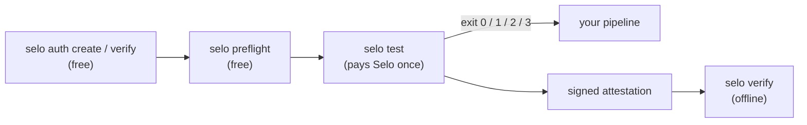

`selo` runs a Selo release test from a terminal or a CI job and turns the verdict into an exit code a pipeline can trust. It authorizes your endpoint, runs the free preflight, pays Selo once from a dedicated, capped wallet, and blocks the release unless every release check passed with evidence. It also verifies Selo's signed attestations offline.



## Install and run

The CLI lives in the Selo repository as the private workspace package `@selo/cli`. It is not published to a package registry: you run it from a checkout.

**Requirements:** Node 24 or later and pnpm 10. The repository pins pnpm `10.33.0` through its `packageManager` field.

```bash Terminal
git clone https://github.com/Enoch208/selo.git
cd selo
pnpm install --frozen-lockfile
pnpm selo --help
```

The root `package.json` defines the script that `pnpm selo` runs:

```json package.json
{
  "scripts": {
    "selo": "node packages/cli/bin/selo.js"
  }
}
```

`packages/cli/bin/selo.js` registers `tsx` and loads `src/main.ts`, so the CLI runs its TypeScript source directly. There is no build step.

- `pnpm selo …` works from anywhere inside the checkout.
- Relative paths you pass (`--body`, `--contract`, `--summary`, `--attestation`, and the files `selo verify` reads) resolve against the directory you ran the command in. The run state directory `.selo/runs/` is created there too.
- Under pnpm, that directory comes from `INIT_CWD`, which pnpm sets for you. When you call `node packages/cli/bin/selo.js` directly, as the [GitHub Action](/cli/github-action) does, it is the current directory.

<Tip>
pnpm prints a short script header before the CLI output and, after a non-zero exit, an `ELIFECYCLE Command failed with exit code …` line. The exit code itself passes through unchanged. Run `pnpm --silent selo …` to see only the CLI's own output.
</Tip>

## Commands

| Command | Pays | What it does |
| --- | --- | --- |
| [`selo auth create`](/cli/auth#selo-auth-create) | No | Requests a verification challenge for one URL and method |
| [`selo auth verify`](/cli/auth#selo-auth-verify) | No | Asks Selo to read your verification file and verify the authorization |
| [`selo auth status`](/cli/auth#selo-auth-status) | No | Shows an authorization's status and expiry |
| [`selo preflight`](/cli/preflight) | No | Checks eligibility and shows every price before you pay |
| [`selo test`](/cli/test) | Yes, once | Runs a fresh preflight, pays Selo once, gates on the verdict |
| [`selo verify`](/cli/verify) | No | Verifies a signed attestation offline against keys you trust |

<CardGroup cols={2}>
  <Card title="selo auth" icon="key" href="/cli/auth">
    Prove you control the endpoint before Selo will touch it.
  </Card>
  <Card title="selo preflight" icon="list-check" href="/cli/preflight">
    Free eligibility check with the target fee, Selo's cap and Selo's price.
  </Card>
  <Card title="selo test" icon="flask" href="/cli/test">
    The paid release gate: one payment, five checks, one exit code.
  </Card>
  <Card title="selo verify" icon="file-signature" href="/cli/verify">
    Check a signed verdict offline for an exact release, URL and method.
  </Card>
  <Card title="Output files" icon="folder-open" href="/cli/files">
    The run state, the `selo.gate.v1` summary, the attestation and the job summary.
  </Card>
  <Card title="GitHub Action" icon="github" href="/cli/github-action">
    The composite action that runs the CLI in a workflow.
  </Card>
</CardGroup>

## Global behaviour

### Syntax

```text
selo <command> [subcommand] --flag value --flag=value …
```

- Flags take a value as `--flag value` or `--flag=value`. Boolean flags (`--approve-mainnet`, `--resume`) take none.
- Values are trimmed. An empty value counts as missing.
- Unknown flags and positional arguments are usage errors.
- A leading `--` is ignored, so `pnpm selo -- test …` behaves like `pnpm selo test …`.

### Help

`selo`, `selo help`, `selo --help` and `selo -h` print the full usage and exit `0`. So does any command that has `help`, `--help` or `-h` among its arguments. There is no per-command help: one usage text covers every command.

```text selo --help (excerpt)
selo: a payment-aware release gate for x402 endpoints on Algorand

Usage:
  selo auth create  --api <url> --url <target> --method GET|POST --project <name> --contact <email>
  selo auth verify  --api <url> --authorization <auth_id>
  selo auth status  --api <url> --authorization <auth_id>
  selo preflight    --api <url> --authorization <auth_id> --url <target> --method GET|POST
                    [--body <file.json>]
  selo test         --api <url> --authorization <auth_id> --url <target> --method GET|POST
                    [--body <file.json>] --contract <file.json> --release <id>
                    --network testnet|mainnet --max-usdc <amount>
                    [--pay-to <Selo payTo>] [--approve-mainnet] [--summary <file.json>]
                    [--attestation <file.json>] [--resume]
  selo verify       --attestation <file.json> --keys <https url|file.json> --release <id>
                    --url <target> --method GET|POST
```

### Usage errors exit 3

Invalid input is caught before any network request. The CLI prints the problem on stderr, followed by `(run selo --help)`, and exits `3`:

```text Terminal
$ pnpm --silent selo deploy
unknown command deploy (run selo --help)
$ pnpm --silent selo preflight --api https://api.useselo.xyz --bogus x
Unknown option '--bogus' (run selo --help)
$ pnpm --silent selo auth verify --api https://api.useselo.xyz --authorization abc
--authorization must look like auth_… or pfl_… (run selo --help)
```

### Unexpected errors exit 2

Any other error stops the CLI with exit `2` and this line on stderr:

```text
selo stopped unexpectedly, the release is not proven: <reason>
```

An unexpected error never exits `0`.

### Output streams

Results go to stdout. Usage errors, refusals, preflight failures, recovery instructions and `selo verify` failures go to stderr.

### Shared validation

These rules apply to every command that takes the flag.

| Flag | Rule | Error message |
| --- | --- | --- |
| `--api` | An `https` URL. `http` is accepted only for `localhost`, `127.0.0.1` and `[::1]`. Only the origin is kept; any path is dropped. | `--api must be an https URL (http only for localhost)` |
| `--url` | An `https` URL. It is normalized, so `https://api.example.com` becomes `https://api.example.com/`. | `--url must be the https URL of the paid endpoint` |
| `--method` | `GET` or `POST`, case-insensitive. | `--method must be one of GET, POST` |
| `--authorization` | A Selo id: lowercase prefix, `_`, then 1 to 60 letters or digits. | `--authorization must look like auth_… or pfl_…` |
| `--release` | 1 to 128 characters of `A-Z`, `a-z`, `0-9`, `.`, `_` or `-`. | `--release must be 1-128 characters of A-Z, a-z, 0-9, '.', '_' or '-'` |
| any required flag | Present and not empty. | `--<name> is required` |

## Environment variables

| Variable | Used by | Description |
| --- | --- | --- |
| `SELO_PAYER_MNEMONIC` | `selo test` | The recovery words of the dedicated, capped payer wallet. The CLI reads them only from the environment and never prints or writes them. If the variable is missing or empty, `selo test` exits `3` with `SELO_PAYER_MNEMONIC is not set: export the dedicated, capped payer wallet`. If it is not a valid Algorand mnemonic, it exits `3` with `SELO_PAYER_MNEMONIC is not a valid Algorand mnemonic`. Both happen before any request. |
| `GITHUB_STEP_SUMMARY` | `selo test` | When set, the sanitized gate summary is appended to this file as Markdown. GitHub Actions sets it for every step. See [Output files](/cli/files#github-step-summary). |
| `INIT_CWD` | every command | Set by pnpm to the directory you ran `pnpm selo` from. Relative paths and `.selo/runs/` resolve against it. You do not set it yourself. |

<Warning>
Never pass the mnemonic as a flag or commit it to a file in your repository. In CI, store it as a secret of a protected environment. See [GitHub Action security](/cli/github-action#security).
</Warning>

## Exit codes

Every command uses the same four codes. `selo test` is the release gate: only `0` allows a release.

| Exit | Meaning | Gate |
| --- | --- | --- |
| `0` | PASS: all five checks present with evidence, none FAIL or INCONCLUSIVE (a WARN does not block), both payment legs in the report | ALLOW |
| `1` | FAIL proven by a release check | BLOCK |
| `2` | INCONCLUSIVE, unconfirmed payment, missing or inconsistent report, transient failure | BLOCK |
| `3` | Invalid input, authorization missing, preflight ineligible, payment not approved (refused before paying) | BLOCK |

What each code means per command:

| Command | `0` | `1` | `2` | `3` |
| --- | --- | --- | --- | --- |
| `selo auth create` | Challenge created | Not used | Selo unreachable, a `5xx`, or an unexpected answer | Invalid input or a `4xx` from Selo |
| `selo auth verify` | Authorization is `VERIFIED` | Not used | Selo unreachable, a `5xx` (including `VERIFICATION_UNREACHABLE`), or an unexpected answer | Invalid input or a `4xx` from Selo (for example `VERIFICATION_FAILED`) |
| `selo auth status` | Authorization is `VERIFIED` | Not used | Selo unreachable, a `5xx`, or an unexpected answer | `PENDING`, `EXPIRED` or `REVOKED`, invalid input, or a `4xx` |
| `selo preflight` | Eligible | Not used | Selo unreachable, a `5xx`, or an unexpected answer | Ineligible, invalid input, or a `4xx` |
| `selo test` | Fully evidenced PASS | Proven FAIL | INCONCLUSIVE, unconfirmed payment, inconsistent report, Selo unreachable | Refused before paying |
| `selo verify` | Attested PASS | Attested FAIL | Attested INCONCLUSIVE, or the attestation cannot be verified | Invalid input, or `--keys` given as an `http://` URL |

The CLI does not trust a verdict label on its own. `selo test` recomputes the verdict from the report's own checks with the same reducer Selo uses, and blocks with exit `2` on any disagreement or gap. See [How the gate decides](/cli/test#how-the-gate-decides) and [Verdicts and the gate](/concepts/verdicts).

## Payment approval rules

Only `selo test` pays, and it pays Selo once per run. It never retries a payment on its own.

<Steps>
  <Step title="Before any request">
    `--network mainnet` needs both `--approve-mainnet` and `--pay-to <Selo's payTo>`, or the CLI exits `3` with `--network mainnet needs --approve-mainnet and --pay-to <Selo's payTo address>`. A missing or invalid `SELO_PAYER_MNEMONIC` also exits `3`.
  </Step>
  <Step title="Before signing">
    The CLI reads Selo's 402 and shows the price, network, payee, payer and tag. It refuses to sign, and exits `3` (`2` while resuming), when:

    - the 402 does not offer exactly one `exact` Algorand USDC requirement (ASA `31566704` on Mainnet, `10458941` on Testnet);
    - the 402 asks for payment on a network other than `--network`;
    - `--pay-to` is set and the 402 names another payee;
    - the payer is the payee (self-payment);
    - the price is zero or above `5.00` USDC;
    - the price is above `--max-usdc`.
  </Step>
  <Step title="After sending">
    If the outcome cannot be confirmed (a timeout, a lost connection, a redirect, a held settlement), the CLI records the attempt in `.selo/runs/<release>.json` and exits `2`. Further runs for that release refuse to pay until you rerun the same command with `--resume`. See [Recover an interrupted run](/guides/resume).
  </Step>
</Steps>

Use a dedicated payer wallet that holds only what a few release tests cost, and opt it in to USDC. A release test costs Selo's price, 1.00 USDC on the public API. Selo pays the target's own price from its wallet. See [Payments and spend limits](/concepts/payments).

## Network access

The CLI makes requests to these hosts:

| Host | Commands | Why |
| --- | --- | --- |
| The `--api` origin, for example `https://api.useselo.xyz` | `auth`, `preflight`, `test` | Selo's API |
| `https://mainnet-api.algonode.cloud` or `https://testnet-api.algonode.cloud` | `test` | Algorand node used to build the payment transaction |
| The `--keys` URL, when it is an `https` URL | `verify` | Downloads the trusted key set |

Each request to Selo, and the key download in `selo verify`, times out after 300 seconds. A release test is one long request: Selo waits for its own settlement and the call to your endpoint before it answers. A timeout on the paid request counts as an unconfirmed outcome, never as a failure that is safe to retry.

## Scope

`quick` profile only, `GET` and `POST` targets, Algorand USDC on Mainnet or Testnet. Any other method or network exits `3`. The public API at `https://api.useselo.xyz` runs on Algorand Mainnet; `--network testnet` is for a Selo deployment that runs on Testnet.

## Related

- [Quickstart](/quickstart) walks through the four commands end to end.
- [Run a release test](/guides/run-release-test) and [Gate deploys in GitHub Actions](/guides/github-actions) are the task guides.
- [Output files](/cli/files) documents every file the CLI reads and writes.
