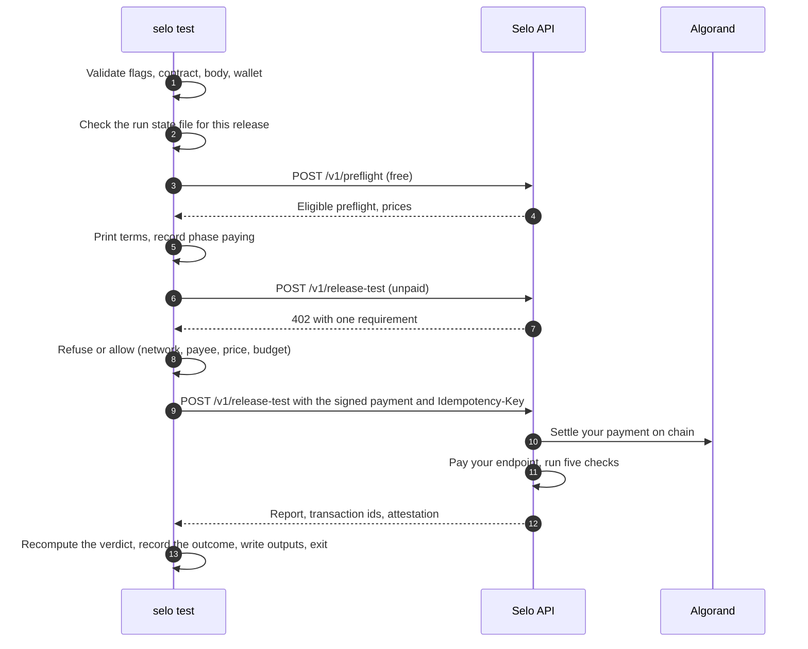

`selo test` is the release gate. It runs a fresh preflight, shows every price, pays Selo once from the wallet in `SELO_PAYER_MNEMONIC`, and waits while Selo pays your endpoint as a real x402 client and runs the five release checks. It exits `0` only for a PASS on every check, each with evidence, with both payment legs in the report. Anything else blocks the release.

```text
selo test --api <url> --authorization <auth_id> --url <target> --method GET|POST
          [--body <file.json>] --contract <file.json> --release <id>
          --network testnet|mainnet --max-usdc <amount>
          [--pay-to <Selo payTo>] [--approve-mainnet] [--summary <file.json>]
          [--attestation <file.json>] [--resume]
```

## Before you start

- A `VERIFIED` authorization for the exact URL and method. See [selo auth](/cli/auth).
- A release contract file. See [Write a release contract](/guides/release-contract).
- A dedicated payer wallet, opted in to USDC (ASA `31566704` on Mainnet, `10458941` on Testnet) and funded with only what a few release tests cost. Export its recovery words as `SELO_PAYER_MNEMONIC`.
- On Mainnet, Selo's payTo address for `--pay-to`. See [Finding the payTo address](#finding-the-payto-address).

## Flags

| Flag | Required | Value | Description |
| --- | --- | --- | --- |
| `--api` | Yes | `https` URL | Selo's API origin, for example `https://api.useselo.xyz`. `http` is accepted only for `localhost`, `127.0.0.1` and `[::1]`. |
| `--authorization` | Yes | `auth_…` | A `VERIFIED` authorization that covers the target. |
| `--url` | Yes | `https` URL | Your paid x402 endpoint. |
| `--method` | Yes | `GET` or `POST` | The method to test. Case-insensitive. |
| `--body` | No | path to a JSON file | Request body for a `POST` target, sent with the preflight. Only allowed with `--method POST`. |
| `--contract` | Yes | path to a JSON file | The release contract a paid response must satisfy. Sent to Selo as `expected`. |
| `--release` | Yes | 1 to 128 characters of `A-Z a-z 0-9 . _ -` | The build you are testing, for example a Git SHA. Names the run state file. |
| `--network` | Yes | `testnet` or `mainnet` | The network you expect Selo's 402 to ask for. |
| `--max-usdc` | Yes | positive decimal, up to 6 decimals | The most this run may pay Selo, for example `1.00`. |
| `--pay-to` | On Mainnet | Algorand address | Selo's expected payTo. The 402 must name exactly this address. |
| `--approve-mainnet` | On Mainnet | flag | Allows a payment on Algorand Mainnet. |
| `--summary` | No | file path | Where to write the sanitized `selo.gate.v1` summary. |
| `--attestation` | No | file path | Where to save Selo's signed attestation. |
| `--resume` | No | flag | Resume the unconfirmed run recorded for this release instead of starting a new one. |

Relative paths resolve against the directory you ran the command in.

### --max-usdc

Your budget for what you pay Selo, compared with the price in Selo's 402 before anything is signed. It does not limit what Selo spends on your endpoint: Selo's own per-job cap does that. The value is a decimal string such as `1`, `1.00` or `0.5`, with at most six decimal places, and must be above zero. Whatever you pass, the CLI refuses any price above `5.00` USDC.

### --network, --approve-mainnet and --pay-to

`--network` names the network you expect, and the CLI refuses a 402 on any other network. `--network mainnet` also needs `--approve-mainnet` and `--pay-to`, checked before any request:

```text
--network mainnet needs --approve-mainnet and --pay-to <Selo's payTo address>
```

`--pay-to` works on Testnet too: when you set it, a 402 that names any other payee is refused before signing. The public API at `https://api.useselo.xyz` runs on Mainnet; use `--network testnet` with a Selo deployment that runs on Testnet.

#### Finding the payTo address

Selo's payee is the `payTo` of the single requirement in the 402 that Selo returns for `POST /v1/release-test`. An unpaid request to that route with a valid preflight id returns the 402 and charges nothing; see [Pay with any x402 client](/guides/any-x402-client). The Mainnet 402 captured from the public API on 30 September 2026 ([`g1-402-response.json`](https://github.com/Enoch208/selo/blob/main/docs/evidence/g1-402-response.json)) names:

```text
N37HMJCB4BAITC2ZU7C4XW7PUMCO4T3TUASHQEL6A4EWMLOTTHOB7IOOKY
```

If Selo's 402 names a different address than `--pay-to`, the CLI refuses before signing and prints both addresses:

```text
refusing: the 402 names payTo <address in the 402>, not the expected <your --pay-to>
```

### --release

`--release` names the build under test. Selo does not verify it: the summary and the attestation record it as `asserted_by_client`. The CLI sends it as `deploymentId`, Selo binds it into the signed attestation, and [`selo verify`](/cli/verify) refuses an attestation for any other release. It also names the local run state file, `.selo/runs/<release>.json`.

### --contract

A JSON object with the shape of the `expected` field of `POST /v1/release-test`. Every key is optional, and no other key is allowed:

| Key | Type | Rule |
| --- | --- | --- |
| `status` | integer | The expected HTTP status, `100` to `599`. Defaults to `200`. |
| `contentType` | string | A `type/subtype` media type, at most 200 characters. |
| `jsonSchema` | object | A JSON Schema for the paid response body, at most 16 KiB once serialized. |

```json contract.json
{
  "status": 200,
  "contentType": "application/json",
  "jsonSchema": {
    "type": "object",
    "required": ["receiptId"],
    "properties": { "receiptId": { "type": "string" } }
  }
}
```

The CLI compiles the schema in strict mode before anything is paid, with the same compiler Selo uses. A schema that does not compile exits `3`. For example, every name in `required` must also appear under `properties`, so this contract is refused:

```json bad-contract.json
{ "jsonSchema": { "type": "object", "required": ["a"] } }
```

```text Terminal
the contract file bad-contract.json is not usable: jsonSchema failed to compile: strict mode: required property "a" is not defined at "#" (strictRequired) (run selo --help)
```

The file itself must be valid JSON of at most 64 KiB.

### --body

The JSON request body for a `POST` endpoint: valid JSON other than `null`, at most 64 KiB in the file and 16 KiB once serialized by Selo. The CLI sends it with the preflight as `requestBody`, and Selo uses it for every request it makes to your endpoint. With `--method GET`, the CLI exits `3` with `--body is only allowed with --method POST`.

### --summary and --attestation

`--summary` writes the [`selo.gate.v1` summary](/cli/files#the-gate-summary), sanitized and safe to upload as a CI artifact. `--attestation` saves Selo's [signed attestation](/cli/files#the-attestation-file), which holds no secret and is safe to publish. Parent directories are created, and an existing file is overwritten. If Selo returns no attestation, the CLI prints `attestation none: Selo issued no signed attestation for this run` and writes no file.

Both are written only when the run reaches the payment stage. A run that stops at input validation, the run state check or the preflight writes neither.

### --resume

Reruns the payment of the unconfirmed run recorded in `.selo/runs/<release>.json`, with the same preflight and the same `Idempotency-Key`. Selo never settles a duplicate for the same key. See [Resuming an unconfirmed run](#resuming-an-unconfirmed-run).

## What it does



<Steps>
  <Step title="Validate input">
    Every flag, the contract file and the body file are read and validated, and the contract schema is compiled. The Mainnet approval rule and the `--body` rule are checked. Then the CLI loads the payer wallet from `SELO_PAYER_MNEMONIC`. Any problem exits `3` before a single request.
  </Step>
  <Step title="Check the run state">
    The CLI reads `.selo/runs/<release>.json`. If the last run for this release is still `paying` or `unresolved`, it prints recovery instructions and exits `2` without contacting Selo. If the file cannot be read, it exits `2` and asks you to inspect it.
  </Step>
  <Step title="Run a fresh preflight">
    `POST /v1/preflight` with the authorization, URL, method and body. An ineligible or refused preflight exits `3`, an unavailable one exits `2`, and nothing is paid. With `--resume`, this step is skipped and the recorded preflight is reused.
  </Step>
  <Step title="Show the terms">
    On a fresh run, the CLI prints the release, target, preflight id and expiry, the target fee, Selo's cap, Selo's price and network, your budget and the payer address. Then it records the attempt with phase `paying`, before sending anything to the paid route.
  </Step>
  <Step title="Read Selo's 402">
    An unpaid `POST /v1/release-test` with the body `{ preflightId, profile: "quick", expected, deploymentId }`. The 402 must offer exactly one `exact` Algorand USDC requirement. The CLI prints its price and asset, network, payTo, your payer address and its tag.
  </Step>
  <Step title="Decide whether to sign">
    The CLI refuses to sign when the network differs from `--network`, the payee differs from `--pay-to`, the payer is the payee, the price is zero or above `5.00` USDC, or the price is above `--max-usdc`.
  </Step>
  <Step title="Pay once">
    The CLI signs exactly that one requirement and sends the same body once, with the payment header and `Idempotency-Key: selo-cli-<48 hex characters>`. The key is the first 48 hex characters of the SHA-256 of `<preflight id>:<payer address>`. Nothing is retried automatically. It prints the HTTP status and the settlement transaction id from Selo's `PAYMENT-RESPONSE` header.
  </Step>
  <Step title="Conclude">
    The CLI parses the answer, recomputes the verdict and decides the gate. It records the outcome in the run state file, prints the verdict, each check, the job id, both transaction ids, the redacted report link and the gate line. If the outcome is unconfirmed, it also prints recovery instructions.
  </Step>
  <Step title="Write outputs and exit">
    It writes `--summary`, appends to `GITHUB_STEP_SUMMARY` when set, saves `--attestation`, and exits with the gate's code.
  </Step>
</Steps>

## Output

This is the output format of a passing run, filled in with the job, transaction and key values of the fixed-v2 run against the demo merchant on Algorand Mainnet on 26 October 2026. The preflight id, expiry, payer, payTo and paths are placeholders. All of it goes to stdout.

```text Terminal
$ SELO_PAYER_MNEMONIC="…" pnpm selo test --api https://api.useselo.xyz \
    --authorization auth_… --url https://demo.useselo.xyz/v1/orders --method POST \
    --body examples/merchant/order.json --contract examples/merchant/contract.json \
    --release fixed-v2 --network mainnet --max-usdc 1.00 --approve-mainnet --pay-to <Selo payTo> \
    --summary fixed-v2.json --attestation fixed-v2-attestation.json
release     fixed-v2 (asserted by you, not verified by Selo)
target      POST https://demo.useselo.xyz/v1/orders
preflight   pfl_…, valid until <expiry>
target fee  0.01 USDC, paid by Selo from its own wallet
Selo cap    0.01 USDC at most spent on the target
you pay     1.00 USDC to Selo on algorand-mainnet
budget      1.00 USDC approved for this run
payer       <payer address>
price    1.00 USDC (asset 31566704)
network  algorand:wGHE2Pwdvd7S12BL5FaOP20EGYesN73ktiC1qzkkit8=
payTo    <Selo payTo>
payer    <payer address>
tag      x402-global-challenge
status   200
inbound  EPBEZR22SZ5LYKFM7UJYCSFG5IWNA6QYZ6XHUA6KGTTDDQQ5UIJA
verdict     PASS
check       handshake           PASS          HANDSHAKE_VALID
check       paid_delivery       PASS          PAID_AND_DELIVERED
check       response_contract   PASS          CONTRACT_MATCHED
check       discovery_contract  PASS          DISCOVERY_CONSISTENT
check       retry_safety        PASS          PASS_REPLAY_REJECTED
job         job_51AZ2WJZ78RF1WZC316Q1K38GG
inbound     EPBEZR22SZ5LYKFM7UJYCSFG5IWNA6QYZ6XHUA6KGTTDDQQ5UIJA
downstream  QEUF5D33T4YHYP3KKIY2PGCYF55XXSUYKS5GXFBAVAZ4IEZOE3ZQ
report      https://api.useselo.xyz/v1/reports/<private> (private link saved in <dir>/.selo/runs/fixed-v2.json)
gate        ALLOW (exit 0): PASS on every release check
attestation <dir>/fixed-v2-attestation.json (signed by selo-ed25519-728fcf85650b128f)
```

The broken-v1 run at the same URL ended like this:

```text Terminal
verdict     FAIL
check       handshake           PASS          HANDSHAKE_VALID
check       paid_delivery       PASS          PAID_AND_DELIVERED
check       response_contract   FAIL          SCHEMA_MISMATCH
check       discovery_contract  INCONCLUSIVE  CATALOG_UNAVAILABLE
check       retry_safety        PASS          PASS_REPLAY_REJECTED
job         job_189NZ481HFH77CRGF60AEF22RG
inbound     SVGTX3U6XQLSGJP7L7X7KNPSDLWFBSA3JK7AFNHPWENIWP4YVIEQ
downstream  RZR6XUIA3GTHW6ABAHUIXRDCNYYXIHQVQYGN2T5PAMDO37DDDOLQ
report      https://api.useselo.xyz/v1/reports/<private> (private link saved in <dir>/.selo/runs/broken-v1.json)
gate        BLOCK (exit 1): FAIL: response_contract
```

`inbound` is the transaction in which you paid Selo, and `downstream` lists the transactions in which Selo paid your endpoint. Look them up at `https://allo.info/tx/<txId>`. Warnings from the report, if any, print as `warning` lines after the checks. See [Proof on Algorand Mainnet](/resources/mainnet-proof) for both runs.

### What is never printed

- The mnemonic in `SELO_PAYER_MNEMONIC`. It is never printed or written to any file.
- The signed payment. It is sent once to Selo and never printed or stored.
- The private report token. The report link is redacted to `…/v1/reports/<private>` in the terminal, in `--summary` and in `GITHUB_STEP_SUMMARY`. The full link is kept only in the run state file, which is written with mode `600`.

A test in `packages/cli/tests/` runs a full release test and scans the terminal output, the summary, the job summary and the state file for the mnemonic and the signed payment, and every published output for the report token.

## How the gate decides

The CLI does not trust the verdict label. When Selo answers `200`, it checks the report's shape and then recomputes the verdict from the report's own checks with the same pure reducer Selo uses.

| Condition | Gate | Exit | Reason printed |
| --- | --- | --- | --- |
| Recomputed PASS, all five checks present, an inbound transaction, at least one downstream transaction, a report link | ALLOW | `0` | `PASS on every release check` |
| Recomputed FAIL | BLOCK | `1` | `FAIL: <failed check ids>` |
| Recomputed INCONCLUSIVE | BLOCK | `2` | `INCONCLUSIVE: <inconclusive reason>` |
| The recomputed verdict differs from the reported one, or a check appears twice | BLOCK | `2` | `the reported verdict <verdict> does not follow from its checks (<recomputed>)` |
| PASS without a check, an inbound transaction, a downstream transaction or a report link | BLOCK | `2` | `PASS is not fully evidenced: <what is missing>` |
| The `200` body is not a Selo report | BLOCK | `2` | `the release test answer is not a Selo report (<fields>)` |

A FAIL counts only when a blocking check failed with evidence. A FAIL without evidence recomputes as INCONCLUSIVE, so the reported FAIL disagrees and the CLI exits `2`. See [Verdicts and the gate](/concepts/verdicts) and [The five release checks](/concepts/checks).

## Exit paths

Every way `selo test` can end, in the order the CLI meets them. "Phase" is what the [run state file](/cli/files#the-run-state-file) records; a dash means no state is written.

### Before any request

| Cause | Message | Exit | Phase |
| --- | --- | --- | --- |
| A flag is missing or invalid | for example `--max-usdc must be a positive USDC amount such as 1.00` | `3` | - |
| The contract file cannot be read, is over 64 KiB, is not JSON, has another key, or does not compile | `could not read the contract file <path>`, `the contract file <path> is larger than 64 KiB`, `… is not valid JSON`, `… must be { status?, contentType?, jsonSchema? }: <issue>`, `… is not usable: <issue>` | `3` | - |
| The body file cannot be read, is over 64 KiB, is not JSON, or is `null` | `could not read the request body file <path>` and the matching messages above | `3` | - |
| Mainnet without approval | `--network mainnet needs --approve-mainnet and --pay-to <Selo's payTo address>` | `3` | - |
| A body with `GET` | `--body is only allowed with --method POST` | `3` | - |
| No payer wallet | `SELO_PAYER_MNEMONIC is not set: export the dedicated, capped payer wallet` | `3` | - |
| Invalid payer wallet | `SELO_PAYER_MNEMONIC is not a valid Algorand mnemonic` | `3` | - |

### Run state

| Cause | Message | Exit | Phase |
| --- | --- | --- | --- |
| The state file exists but cannot be read or parsed | `the run state <path> is unreadable; inspect it before paying again` | `2` | unchanged |
| The last run for this release is `paying` or `unresolved`, and `--resume` is not set | recovery instructions, see [below](#resuming-an-unconfirmed-run) | `2` | unchanged |
| `--resume` with no recorded run | `nothing to resume: no earlier run is recorded for release <release>` | `3` | - |
| `--resume` with a different API, URL, method, network or payer | `--resume must use the same --api, --url, --method, --network and payer as the run it resumes` | `3` | unchanged |
| `--resume` when the last run is `rejected` or `concluded` | `the last run for release <release> is already <phase>: <message>` | `3` | unchanged |

### Preflight

| Cause | Message | Exit | Phase |
| --- | --- | --- | --- |
| Selo unreachable, a `5xx`, or an unexpected answer | `preflight unavailable, nothing was paid: <cause>` | `2` | - |
| Ineligible, for example an expired authorization | `preflight ineligible (<REASON>), nothing was paid: <message>` | `3` | - |
| Another `4xx` | `preflight refused, nothing was paid: HTTP <status> <error>: <message>` | `3` | - |

The reason codes are listed on [selo preflight](/cli/preflight#not-eligible).

### Selo's 402 (nothing signed yet)

These outcomes are definite: nothing was signed or sent. A new run for the release is allowed afterwards. While resuming, every one of them exits `2` and keeps the run `unresolved`.

| Cause | Message | Exit | Phase |
| --- | --- | --- | --- |
| Selo unreachable, redirects, or answers with a `5xx` | `unpaid request failed: <cause>`, `target redirected (HTTP <status> to <location>); nothing further sent`, or `expected a 402 with PAYMENT-REQUIRED, got HTTP <status>: …` | `2` | `rejected` |
| Selo answers with a `4xx` other than `402`, for example `409 PREFLIGHT_EXPIRED` or `403 AUTHORIZATION_INVALID` | `expected a 402 with PAYMENT-REQUIRED, got HTTP <status>: <body>` | `3` | `rejected` |
| No valid x402 challenge | `expected a 402 with PAYMENT-REQUIRED, …` or `PAYMENT-REQUIRED is not an x402 challenge: <issue>` | `3` | `rejected` |
| Not exactly one `exact` Algorand USDC requirement | `expected exactly one Algorand USDC requirement, found <n>` | `3` | `rejected` |
| The 402's network is not `--network` | `refusing: the 402 asks for payment on <network>, not the expected <network>` | `3` | `rejected` |
| The payer is the payee | `refusing: the payer is the payTo address (self-payment)` | `3` | `rejected` |
| The payee is not `--pay-to` | `refusing: the 402 names payTo <address>, not the expected <address>` | `3` | `rejected` |
| The price is zero or above 5.00 USDC | `refusing: the price is not between 0 and 5.00 USDC` | `3` | `rejected` |
| The price is above `--max-usdc` | `refusing: the price <price> USDC is above the approved budget of <max> USDC` | `3` | `rejected` |
| An error before the paid request was sent, for example while building the payment | `<cause>; nothing was sent` | `2` | `rejected` |

### The paid request

Once the signed payment is sent, only an answer from Selo can confirm what happened.

| Selo's answer | Message | Exit | Phase |
| --- | --- | --- | --- |
| `200` with a report | the gate decision above | `0`, `1` or `2` | `concluded` |
| `200` that is not a report | `the release test answer is not a Selo report (<fields>)` | `2` | `concluded` |
| `402` | `Selo did not accept the payment, nothing was charged: HTTP 402 …` | `3` | `rejected` (`unresolved` while resuming) |
| `JOB_IN_PROGRESS` | `the release test is still running; resume later: …` | `2` | `unresolved` |
| `JOB_TERMINAL` | `the release test finished without a report: …` | `2` | `concluded` |
| `FACILITATOR_UNAVAILABLE` | `the facilitator could not verify the payment, nothing was charged: …` | `2` | `rejected` (`unresolved` while resuming) |
| Any other `4xx` | `Selo refused the release test: HTTP <status> …` | `3` (`2` while resuming) | `rejected` (`unresolved` while resuming) |
| A `5xx`, for example `502 INBOUND_SETTLEMENT_UNRESOLVED` or `500 INBOUND_RECORD_FAILED` | `the payment outcome is not confirmed; do not pay again blindly: …` | `2` | `unresolved` |
| No answer: a lost connection or the 300-second timeout | `paid request failed in transit (<cause>); it may have settled. Check the payer account on chain for <txId>; do not pay again blindly.` | `2` | `unresolved` |
| A redirect | `paid request: target redirected (…). The signed payment reached <url> only; it may have settled. …` | `2` | `unresolved` |
| An error after the paid request was sent | `<cause> after the paid request was sent; it may have settled. …` | `2` | `unresolved` |

A `402` usually means the payer holds too little USDC or is not opted in to it. See [Errors and reason codes](/api-reference/errors) for what each API code means.

### Anything else

An unexpected error, for example a summary path that cannot be written, prints `selo stopped unexpectedly, the release is not proven: <reason>` and exits `2`.

## Resuming an unconfirmed run

When the outcome of a sent payment is unconfirmed, the CLI keeps the run `unresolved` and prints, on stderr:

```text Terminal
release <release> has an unconfirmed paid run (unresolved): <message>
Do not start a new paid run for this release; that could pay a second time.
Resume it instead: rerun the same selo test command with --resume. It reuses the same preflight and Idempotency-Key, and Selo never settles a duplicate.
Check the payer account for transaction <expected transaction id> on an Algorand explorer.
Run state: <dir>/.selo/runs/<release>.json
```

Every later `selo test` for that release prints the same instructions and exits `2` without contacting Selo, until you resume:

```bash Terminal
SELO_PAYER_MNEMONIC="…" pnpm selo test <the same flags as before> --resume
```

`--resume` skips the preflight, reads Selo's 402 again, and sends the paid request with the recorded preflight and `Idempotency-Key`. If Selo already settled that request, it returns the existing job's result. If the job is still running, the run stays `unresolved`: resume again later.

Resuming works while the recorded preflight is still valid, for 15 minutes after it was created. After that Selo refuses the unpaid request with `PREFLIGHT_EXPIRED` and the run stays `unresolved`. Check the payer account for the expected transaction id the CLI printed. See [Recover an interrupted run](/guides/resume) and [Held payments and reconciliation](/concepts/reconciliation).

<Warning>
A `concluded` or `rejected` run does not block the next one. Running `selo test` again for the same release starts a new preflight and a new payment.
</Warning>

## Examples

<CodeGroup>

```bash Mainnet, public API
export SELO_PAYER_MNEMONIC="…"
pnpm selo test --api https://api.useselo.xyz --authorization auth_… \
  --url https://staging.example.com/v1/orders --method POST \
  --body order.json --contract contract.json --release "$(git rev-parse HEAD)" \
  --network mainnet --max-usdc 1.00 --approve-mainnet --pay-to <Selo payTo> \
  --summary selo-gate.json --attestation selo-attestation.json
```

```bash GET endpoint
pnpm selo test --api https://api.useselo.xyz --authorization auth_… \
  --url https://staging.example.com/v1/quote --method GET \
  --contract contract.json --release "$GIT_SHA" \
  --network mainnet --max-usdc 1.00 --approve-mainnet --pay-to <Selo payTo>
```

```bash Testnet deployment of Selo
pnpm selo test --api https://selo.example.com --authorization auth_… \
  --url https://staging.example.com/v1/orders --method POST \
  --body order.json --contract contract.json --release "$GIT_SHA" \
  --network testnet --max-usdc 1.00
```

```bash Branch on the exit code
pnpm selo test …
case $? in
  0) echo "PASS: promote" ;;
  1) echo "FAIL: a release check proved a defect" ; exit 1 ;;
  2) echo "Not proven: check the payment before running again" ; exit 1 ;;
  3) echo "Refused before paying: fix the input" ; exit 1 ;;
esac
```

</CodeGroup>

## Related

- [Run a release test](/guides/run-release-test) is the step-by-step guide.
- [Output files](/cli/files) documents the state file, the summary and the attestation.
- [GitHub Action reference](/cli/github-action) runs this command in a protected CI job.
- [selo verify](/cli/verify) checks the saved attestation offline.
