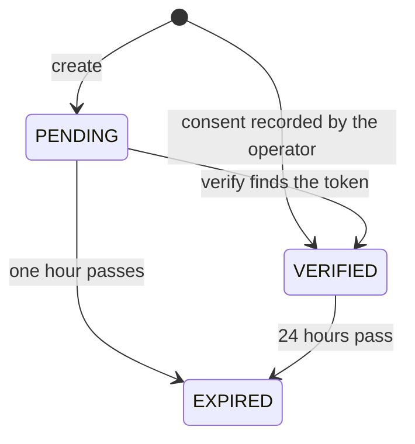

Selo sends real requests and real payments. A release test pays your endpoint, then replays the identical signed payment against it. Pointed at someone else's API, that would be unwanted traffic with money attached. So Selo tests a route only while a verified, unexpired authorization covers its exact origin, path and method. Consent is never inferred.

## Scope

An authorization covers one route and one method. Selo compares all three parts exactly.

| Part | What it is | Example |
| --- | --- | --- |
| Origin | `https://` plus the hostname. Only the default port is allowed | `https://api.example.com` |
| Route path | The URL path, matched exactly. The query string and fragment are not part of the scope, and `/v1/orders` and `/v1/orders/` are different routes | `/v1/orders` |
| Method | `GET` or `POST` | `POST` |

To test `GET` and `POST` on the same path, or two paths on the same origin, create one authorization for each.

The target URL must also pass Selo's address rules: HTTPS only, no user name or password in the URL, no explicit port, a hostname rather than an IP address, at least two labels, and not a local name such as `.local` or `.internal`. See the [security model](/concepts/security#target-url-rules).

## Two ways to authorize

<Tabs>
  <Tab title="Well-known file">
    The standard method, available to anyone through the API or the CLI. You prove control of the origin by serving a token Selo gave you. The authorization's `type` is `well_known_file`.
  </Tab>
  <Tab title="Manual owner consent">
    For an endpoint whose owner cannot serve a file, the Selo operator can record the owner's consent explicitly. The authorization's `type` is `manual_owner_consent`. There is no API route for it, and Selo never creates one on its own.
  </Tab>
</Tabs>

## The well-known file method

<Steps>
  <Step title="Create the authorization">
    Send the target URL, the method, a project name (1 to 80 characters) and a contact (3 to 200 characters).

    ```bash Terminal
    curl -X POST https://api.useselo.xyz/v1/authorizations \
      -H "content-type: application/json" \
      -d '{"targetUrl":"https://api.example.com/v1/orders","method":"POST","project":"orders-api","contact":"you@example.com"}'
    ```

    Selo answers `201` with a pending authorization and the line to publish:

    ```json 201 Created
    {
      "authorizationId": "auth_…",
      "status": "PENDING",
      "origin": "https://api.example.com",
      "routePath": "/v1/orders",
      "method": "POST",
      "verificationUrl": "https://api.example.com/.well-known/selo-verification.txt",
      "expectedContent": "selo-verification=<token>"
    }
    ```

    The token is 32 random bytes, encoded as 43 base64url characters. This response is the only time Selo returns it.
  </Step>
  <Step title="Publish the line">
    Serve the `expectedContent` line at `verificationUrl`, on the same origin as the route. The file may hold other lines, so one file can carry the tokens for several authorizations on the same origin.

    ```text .well-known/selo-verification.txt
    selo-verification=<token>
    ```
  </Step>
  <Step title="Verify">
    Ask Selo to read the file:

    ```bash Terminal
    curl -X POST https://api.useselo.xyz/v1/authorizations/auth_…/verify
    ```

    ```json 200 OK
    {
      "authorizationId": "auth_…",
      "status": "VERIFIED",
      "origin": "https://api.example.com",
      "routePath": "/v1/orders",
      "method": "POST",
      "type": "well_known_file",
      "verifiedAt": "<time of verification>",
      "expiresAt": "<24 hours after verification>"
    }
    ```
  </Step>
</Steps>

The CLI does the same with `selo auth create`, `selo auth verify` and `selo auth status`. See [Authorize your endpoint](/guides/authorize-endpoint) for the full walkthrough and [selo auth](/cli/auth) for the flags.

### How Selo reads the file

- One `GET` to `<origin>/.well-known/selo-verification.txt` with `accept: text/plain`, through the [SSRF-safe fetch](/concepts/security), with a 10-second timeout.
- Up to 3 redirects are followed, and every hop must stay on the same origin and pass the address checks again.
- The response must be `2xx` and at most 4 KiB.
- Selo trims each line, takes the lines that start with `selo-verification=`, hashes the value after the prefix with SHA-256, and compares it with the stored hash in constant time. One matching line is enough.

Verifying an authorization that is already verified and unexpired returns it unchanged.

| Answer | When |
| --- | --- |
| `200` | The file carries the expected line, or the authorization was already verified |
| `409 VERIFICATION_FAILED` | The file is missing, the status is not `2xx`, the file is larger than 4 KiB, or no line matches |
| `502 VERIFICATION_UNREACHABLE` | The origin did not answer in time, the connection failed, or the body could not be read |
| `422` with the block reason | The safe fetch refused the request: `TARGET_ADDRESS_BLOCKED`, `ORIGIN_NOT_ALLOWED`, `TOO_MANY_REDIRECTS`, `TARGET_NOT_HTTPS` or `TARGET_URL_INVALID` |
| `409 CHALLENGE_EXPIRED` | The pending authorization is more than an hour old. Create a new one |
| `409 AUTHORIZATION_EXPIRED` | The authorization was verified and has since expired. Create a new one |
| `409 AUTHORIZATION_REVOKED` | The authorization was revoked |
| `404 NOT_FOUND` | The id is unknown or malformed |

## Manual owner consent

The operator records consent with a command run against Selo's own database:

```bash Terminal
pnpm --filter @selo/api consent:grant -- \
  --url https://api.example.com/v1/orders \
  --method POST \
  --project orders-api \
  --contact owner@example.com \
  --note "How and when the owner consented"
```

- Every flag is required. `--note` (1 to 1,000 characters) must say how the owner consented, and it is stored with the authorization.
- The target URL passes the same address rules as the well-known method.
- The command writes a `VERIFIED` authorization of type `manual_owner_consent`, prints its id, and the authorization expires after the same 24 hours.

Consent is explicit and recorded. Selo never treats a public listing, a price in a `402` or a Bazaar entry as permission to test a route.

## Statuses

| Status | Meaning |
| --- | --- |
| `PENDING` | Created by `POST /v1/authorizations` and waiting for verification. It expires one hour after creation |
| `VERIFIED` | Selo found the token in the file, or the operator recorded consent. Valid for 24 hours from verification |
| `EXPIRED` | Its expiry passed. Selo marks it `EXPIRED` the next time it reads it. Create a new authorization |
| `REVOKED` | Revoked. Selo refuses to verify it or test against it |



<Info>
  Selo reads the file only when you call verify. Removing the file afterwards does not end the authorization; it stays valid until it expires 24 hours after verification. The public API has no route that revokes an authorization.
</Info>

## Where Selo checks it

Selo checks the authorization at every point where a request or a payment could follow.

| Moment | Requirement | If it fails |
| --- | --- | --- |
| Preflight | Exists, is `VERIFIED`, unexpired, and covers the origin, path and method | `403 AUTHORIZATION_MISSING` (unknown, or a different route or method) or `403 AUTHORIZATION_EXPIRED` (pending, expired or revoked). No probe is sent |
| Paid request, before payment | Is `VERIFIED` and unexpired | `403 AUTHORIZATION_INVALID`. Nothing is charged |
| Start of the run | Is `VERIFIED`, unexpired, and covers the tested target | The job ends INCONCLUSIVE with `AUTHORIZATION_LAPSED`. No request is sent to your endpoint |
| Downstream reservation | Is `VERIFIED`, unexpired, and the payment's origin matches | `paid_delivery` reports `SPEND_GUARD_DENIED` and the run records `AUTHORIZATION_LAPSED`. Nothing is signed |
| Before the replay | Is `VERIFIED`, unexpired, and covers the tested target | `retry_safety` reports `NOT_RUN` and the run records `AUTHORIZATION_LAPSED` |

## When it lapses mid-job

An authorization can expire between your payment and the end of the run. Selo does not let a lapsed authorization through to save the job:

- At the start of the run, a lapse ends the job before any request reaches your endpoint.
- Before the downstream payment, the spend guard refuses to reserve, so nothing is signed.
- After the paid call, the replay is skipped and `retry_safety` reports `NOT_RUN`, so the verdict cannot be PASS. Results already measured keep their evidence, so a FAIL that was already proven stays a FAIL.

Selo has already been paid at the start of the run, so start release tests well inside the authorization's 24 hours. The CLI and the GitHub Action check the authorization through the free preflight before they pay.

Each check at the start of the run and before the replay is recorded as an `authorization_snapshot` evidence record: the authorization's id, type, status, origin, route, method, verification and expiry times, the requested target, whether it was covered and whether it was valid.

## The hashed nonce

Selo stores only the SHA-256 of the verification token, never the token itself. The token appears once, in the `201` response that created the authorization, and no later response returns the token or its hash. During verification Selo hashes each candidate line and compares hashes in constant time.

Once you publish the line, the token is public. Its purpose is to show that whoever requested the authorization controls the origin, not to act as a secret.

## Related

<CardGroup cols={2}>
  <Card title="Authorize your endpoint" icon="key" href="/guides/authorize-endpoint">
    Step-by-step, with the CLI and the API.
  </Card>
  <Card title="Run a preflight" icon="plane-departure" href="/guides/preflight">
    The free check that confirms the authorization and reads your price.
  </Card>
  <Card title="Security model" icon="shield-halved" href="/concepts/security">
    Address rules, DNS pinning and redirect handling.
  </Card>
  <Card title="Errors and reason codes" icon="triangle-exclamation" href="/api-reference/errors">
    Every error the authorization routes return.
  </Card>
</CardGroup>
