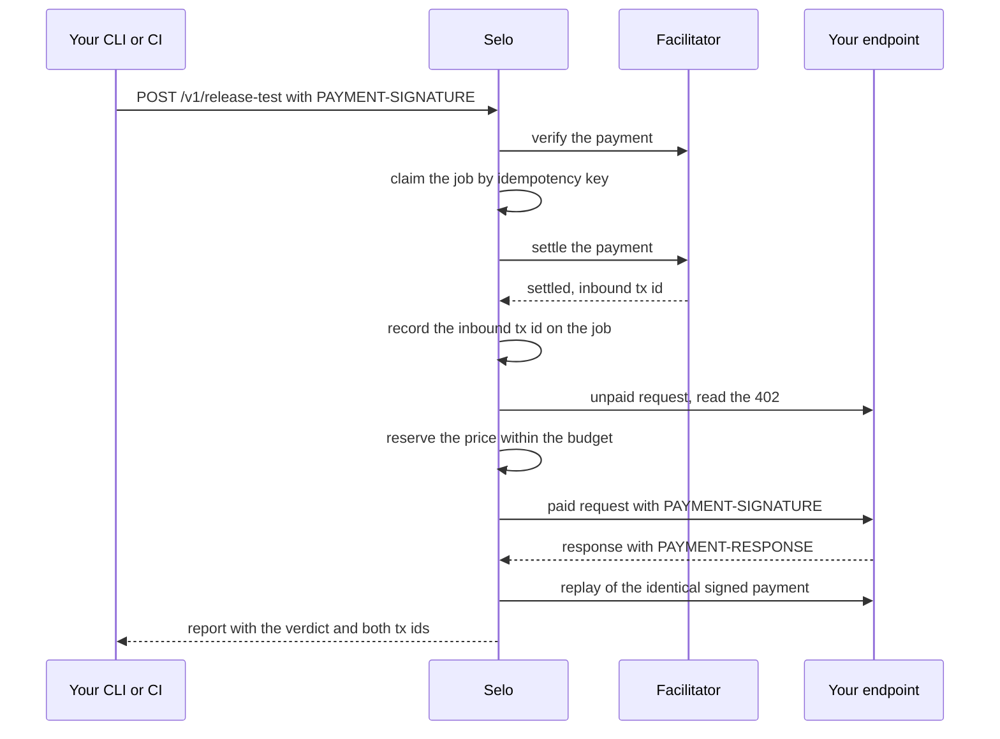
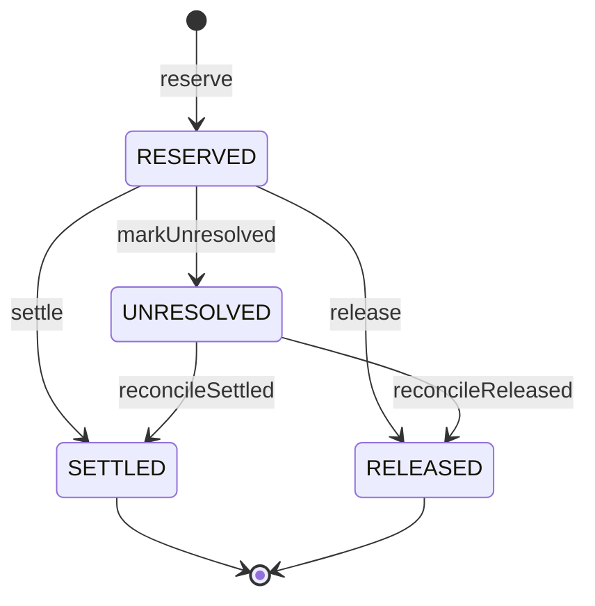
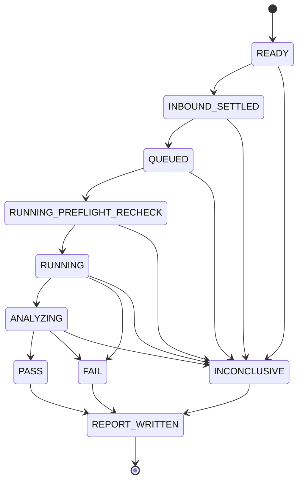
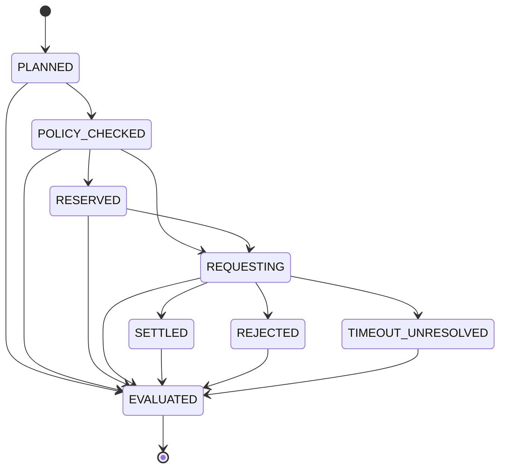

Every release test moves real USDC twice. You pay Selo, then Selo pays your endpoint. Selo never starts the second payment until the first has settled, and it never spends more than the job's budget, even when requests race or outcomes are unclear.

## The two legs

| Leg | From | To | Amount | When |
| --- | --- | --- | --- | --- |
| Inbound | Your payer wallet | Selo | 1.00 USDC per release test | When you call `POST /v1/release-test` with an x402 payment |
| Downstream | Selo's operating wallet | Your endpoint's `payTo` | Your endpoint's price, at most the job budget | During `paid_delivery`, only after the inbound leg has settled |

Both legs are USDC on Algorand Mainnet (ASA `31566704`), and both transaction ids are returned in the report: `money.seloInboundTxId` and `money.downstreamTxIds`. Anyone can look them up on an explorer at `https://allo.info/tx/<txId>`.



## Incoming before outgoing

Selo's paid route does not rely on middleware ordering. It composes each step explicitly:

<Steps>
  <Step title="Validate before any payment">
    Selo validates the request body and the `Idempotency-Key` header, then checks that the preflight exists, is eligible and unexpired, that its authorization is verified, and that the target's price is within the job budget. Any failure here answers with an error and nothing is charged.
  </Step>
  <Step title="Verify the payment">
    The facilitator verifies your x402 payment. A request without a payment gets Selo's `402` challenge.
  </Step>
  <Step title="Claim the job">
    Selo inserts the job row under an idempotency key before it settles anything, so a duplicate request can never settle twice.
  </Step>
  <Step title="Settle and record">
    Selo settles your payment through the facilitator and records the settlement transaction id, payer, amount and time on the job. The inbound transaction id is unique: one settlement can back only one job.
  </Step>
  <Step title="Run">
    The runner starts only a job whose status is `INBOUND_SETTLED` and whose settlement time is recorded. It refuses any other job and contacts no target.
  </Step>
</Steps>

The acceptance test `A12: inbound settles before the first downstream request` checks the recorded timestamps and the call order against a real database.

### Inbound outcomes

| What happened | What Selo does | What you get back |
| --- | --- | --- |
| No payment, or an invalid one | Nothing is claimed | `402` with Selo's challenge |
| The facilitator could not verify the payment | No job is claimed | `502 FACILITATOR_UNAVAILABLE`, nothing charged |
| The payment settled | Records the settlement and runs the job | `200` with the report and the `PAYMENT-RESPONSE` header |
| The facilitator definitely refused to settle | Deletes the claimed job | `402`, nothing charged |
| The settlement outcome is unknown | Holds the job as INCONCLUSIVE with `FACILITATOR_UNAVAILABLE` and keeps the transaction id if one was returned. The job never runs | `502 INBOUND_SETTLEMENT_UNRESOLVED`. Do not pay again for this request |
| The payment settled but Selo could not record it | Alerts, marks the job INCONCLUSIVE with `INTERNAL_ERROR`, never runs it | `500 INBOUND_RECORD_FAILED` with the `PAYMENT-RESPONSE` header |
| The payment settled and the run failed inside Selo | Marks the job INCONCLUSIVE with `INTERNAL_ERROR` | `500 INTERNAL` with the job id and the `PAYMENT-RESPONSE` header |

### The idempotent claim

The job's idempotency key is derived from your request:

- With an `Idempotency-Key` header (8 to 128 characters of `A-Z`, `a-z`, `0-9`, `_` or `-`), the key is a SHA-256 hash of the preflight id and your header value. The same header with two different payments settles once.
- Without the header, the key is a SHA-256 hash of the canonical JSON of your payment payload, so only a resend of the same payment payload counts as a duplicate.

A second request with the same key does not create a job or settle again. It gets the existing job's answer:

| Existing job | Answer |
| --- | --- |
| Finished with a report | `200` with the same report, and the same attestation |
| Still running | `409 JOB_IN_PROGRESS` |
| Held because its inbound settlement is unconfirmed | `502 INBOUND_SETTLEMENT_UNRESOLVED` |
| Ended without a report | `409 JOB_TERMINAL` |

The `selo` CLI sends a stable `Idempotency-Key` for each run, which is what makes [recovering an interrupted run](/guides/resume) safe.

## The downstream leg

Selo signs at most one downstream payment per job. The replay in `retry_safety` reuses that same signed payment; it is not a second payment.

1. **Read the price.** `handshake` selects your `exact` requirement for Algorand Mainnet USDC.
2. **Check the wallet.** Selo confirms its operating wallet can cover the price. If not, nothing is reserved or signed.
3. **Reserve.** The spend guard and one conditional database update reserve the price. See [the budget invariant](#the-budget-invariant).
4. **Sign exactly what was reserved.** The x402 client signs only an entry whose network, asset, amount and `payTo` match the reservation, with its spend cap set to that amount. Selo records the id of the transfer it signed and the transfer's last valid round.
5. **Send once and classify.** The outcome moves the payment to `SETTLED`, `RELEASED` or `UNRESOLVED`, as described below.

## Spend limits

| Limit | Value on `api.useselo.xyz` | Enforced |
| --- | --- | --- |
| Selo's price | 1.00 USDC per release test | In Selo's x402 challenge |
| Target price | At most the job budget | At preflight (`PRICE_OVER_BUDGET`) and again before you pay |
| Job budget (`max_spend`) | 0.50 USDC | By the spend guard, the conditional update and a database CHECK |
| Scenario budget | Equal to the job budget | By the spend guard |
| Absolute cap | 5.00 USDC | Configuration cannot exceed it, a database CHECK rejects any job budget above it, and the spend guard checks it |

## The budget invariant

Before every downstream signature, this must hold:

```text Invariant
settled + reserved + unresolved + amount <= max_spend <= absolute cap (5.00 USDC)
```

`settled`, `reserved` and `unresolved` are counters on the job row, in micro-USDC. Selo enforces the invariant in one database transaction:

1. It evaluates the spend policy on the current job and authorization. The first failing rule becomes the [denial reason](#spend-denial-reasons).
2. It claims capacity with **one conditional `UPDATE`**. There is no read-then-check-then-write in application code:

   ```sql reserve.ts (shape of the generated SQL)
   UPDATE release_jobs
   SET reserved_spend_micros = reserved_spend_micros + $amount
   WHERE id = $job_id
     AND status = 'RUNNING'
     AND unresolved_spend_micros = 0
     AND settled_spend_micros + reserved_spend_micros + unresolved_spend_micros + $amount
         <= max_spend_micros
   RETURNING id;
   ```

3. Zero rows returned means the reservation is denied. Selo re-reads the job to name the reason: `JOB_NOT_RUNNING`, `PAYMENT_UNRESOLVED` or `JOB_BUDGET_EXCEEDED`.
4. In the same transaction, it inserts the `downstream_payments` row with status `RESERVED`.

Database CHECK constraints are the backstop, not the mechanism: `settled + reserved + unresolved <= max_spend`, `max_spend <= 5000000`, every counter non-negative, and every payment amount positive. A settlement transaction id is unique across all downstream payments.

<Check>
  The acceptance test `A16` fires truly parallel reservations at a real PostgreSQL database: three parallel 0.05 USDC reservations against a 0.10 USDC job reserve exactly two, and thirty parallel mixed-size reservations against 0.50 USDC never overspend.
</Check>

### Spend denial reasons

The spend guard evaluates its rules in this order and reports the first that fails. A denied payment is never signed; `paid_delivery` reports `SPEND_GUARD_DENIED` and the run records the inconclusive reason shown.

| Order | Reason | Fails when | Run records |
| --- | --- | --- | --- |
| 1 | `AUTHORIZATION_INVALID` | The authorization is missing or not `VERIFIED` | `AUTHORIZATION_LAPSED` |
| 2 | `AUTHORIZATION_EXPIRED` | The authorization's expiry has passed | `AUTHORIZATION_LAPSED` |
| 3 | `JOB_NOT_RUNNING` | The job is not in status `RUNNING` | `INTERNAL_ERROR` |
| 4 | `ORIGIN_NOT_AUTHORIZED` | The payment's origin differs from the authorized origin | `AUTHORIZATION_LAPSED` |
| 5 | `NETWORK_NOT_ALLOWED` | The payment's network is not Selo's network | `INTERNAL_ERROR` |
| 6 | `ASSET_NOT_ALLOWED` | The payment's asset is not Selo's USDC asset | `INTERNAL_ERROR` |
| 7 | `PAYMENT_UNRESOLVED` | The job already has an unresolved amount | `PAYMENT_UNRESOLVED` |
| 8 | `SCENARIO_BUDGET_EXCEEDED` | The amount is above the scenario budget | `BUDGET_EXHAUSTED` |
| 9 | `JOB_BUDGET_EXCEEDED` | `settled + reserved + unresolved + amount` is above the job budget | `BUDGET_EXHAUSTED` |
| 10 | `ABSOLUTE_CAP_EXCEEDED` | The job budget is above the absolute cap | `BUDGET_EXHAUSTED` |

## Payment states

A downstream payment has four states.

| State | Meaning | Counts against the budget as |
| --- | --- | --- |
| `RESERVED` | Capacity is claimed; the payment may be about to be signed or sent | `reserved` |
| `SETTLED` | The payment settled with a transaction id Selo matched to its own transfer | `settled` |
| `RELEASED` | The payment definitely did not happen; the capacity is free again | Nothing |
| `UNRESOLVED` | The outcome is unknown; Selo holds the amount and stops spending | `unresolved` |



Each transition is a conditional `UPDATE ... WHERE status = <from>` on the payment row plus the matching counter move on the job, in one transaction. A transition that finds the payment already moved changes nothing.

| Transition | `reserved` | `settled` | `unresolved` |
| --- | --- | --- | --- |
| `settle` (RESERVED to SETTLED) | minus amount | plus amount | unchanged |
| `release` (RESERVED to RELEASED) | minus amount | unchanged | unchanged |
| `markUnresolved` (RESERVED to UNRESOLVED) | minus amount | unchanged | plus amount |
| `reconcileSettled` (UNRESOLVED to SETTLED) | unchanged | plus amount | minus amount |
| `reconcileReleased` (UNRESOLVED to RELEASED) | unchanged | unchanged | minus amount |

### What moves a payment

| Event | Transition |
| --- | --- |
| The live requirement cannot be handed to the x402 client, so nothing is signed | RESERVED to RELEASED |
| Signing fails, the address is blocked, or the connection fails before the request leaves Selo | RESERVED to RELEASED |
| Your endpoint returns a settlement transaction id that matches the transfer Selo signed | RESERVED to SETTLED |
| Your endpoint returns a settlement id and Selo could not derive its own transfer id; the claim is recorded as unchecked | RESERVED to SETTLED |
| Your endpoint answers without a settlement transaction id | RESERVED to UNRESOLVED |
| Your endpoint claims a transaction id different from the one Selo signed | RESERVED to UNRESOLVED |
| The claimed transaction id is already recorded on another payment | RESERVED to UNRESOLVED |
| Your endpoint answers the signed payment with a `402` rejection | RESERVED to UNRESOLVED |
| A timeout or a lost connection after the request left Selo, or a `402` with an undecodable `PAYMENT-RESPONSE` | RESERVED to UNRESOLVED |
| An internal error or a restart while the payment is open | RESERVED to UNRESOLVED |
| The operator's [reconcile](/concepts/reconciliation) finds a confirmed matching transfer on chain | UNRESOLVED to SETTLED |
| The operator's reconcile finds Selo's signed transfer absent and the network past its last valid round | UNRESOLVED to RELEASED |

## Why ambiguity stops spending

Once a signed payment has left Selo, a missing answer does not mean the money stayed put. A timeout can hide a settlement that lands a second later, and a signed transfer can be submitted by whoever holds it until its last valid round passes. If Selo released the capacity on a timeout and paid again, it could pay twice.

So Selo treats every unclear outcome the same way:

- The amount moves to `unresolved` and keeps counting against the budget.
- The job stops spending: the spend guard refuses any further reservation while `unresolved` is above zero, and `retry_safety` does not replay.
- The run records `PAYMENT_UNRESOLVED`, and the verdict is INCONCLUSIVE unless a check already proved a FAIL.
- Only a **definite failure before the payment left Selo** releases capacity. A timeout never does.

Unresolved payments are later settled or released only on chain proof. See [Held payments and reconciliation](/concepts/reconciliation).

## Money is integer micro-USDC

Inside Selo, every amount is an integer number of micro-USDC (USDC has 6 decimals). Floating point is never used for money. Decimal strings exist only on the wire and in output, and x402 `amount` fields use atomic units.

| Decimal on the wire | Micro-USDC inside Selo | x402 `amount` |
| --- | --- | --- |
| `"1.00"` | 1,000,000 | `"1000000"` |
| `"0.50"` | 500,000 | `"500000"` |
| `"0.01"` | 10,000 | `"10000"` |
| `"5.00"` | 5,000,000 | `"5000000"` |

Selo parses a decimal only when it has no sign or exponent and at most six fractional digits. It formats with at least two decimals and drops trailing zeros beyond that, so 1,234,500 micro-USDC prints as `"1.2345"`.

## Operation ids and Idempotency-Key

When a job starts, Selo plans one scenario per check. Each scenario gets an immutable operation id, `<jobId>:<checkId>`, unique within the job and enforced by a database unique index. A retry of the same logical operation reuses its id.

| Request to your endpoint | `Idempotency-Key` |
| --- | --- |
| Preflight probe | `preflight-<preflightId>` |
| `handshake` unpaid request | `<jobId>:handshake` |
| `paid_delivery` paid request | `<jobId>:paid_delivery` |
| `retry_safety` replay | `<jobId>:paid_delivery`, the same key as the paid request, because it is the same operation retried |

When your challenge declares the x402 payment-identifier extension, Selo also sends a payment id derived from the operation id: `selo_` followed by the operation id with every character outside `A-Z`, `a-z`, `0-9`, `_` and `-` replaced by `_`, padded or cut to the extension's length limits. The report lists each scenario's operation id and attempt count.

## Job states



| State | Meaning |
| --- | --- |
| `READY` | The job is claimed for your paid request; your payment is verified but not yet settled |
| `INBOUND_SETTLED` | Your payment settled and its transaction id, payer, amount and time are recorded |
| `QUEUED` | The runner has claimed the job |
| `RUNNING_PREFLIGHT_RECHECK` | Scenarios are planned and the authorization is checked again |
| `RUNNING` | The checks are running. This is the only state in which a downstream payment can be reserved |
| `ANALYZING` | All checks have run and the verdict is being reduced |
| `PASS`, `FAIL`, `INCONCLUSIVE` | The verdict is recorded |
| `REPORT_WRITTEN` | The evidence packet is written and the report link works. No transition leaves this state |

Every job transition is a conditional update from the expected state, so two processes can never move the same job twice. A job whose inbound settlement is unconfirmed stops at `INCONCLUSIVE` and never gets a report.

## Scenario states



| State | Meaning |
| --- | --- |
| `PLANNED` | Created with the job, with its operation id |
| `POLICY_CHECKED` | Its preconditions, and for `paid_delivery` the spend guard, were evaluated |
| `RESERVED` | Budget is reserved (`paid_delivery` only) |
| `REQUESTING` | The request to your endpoint is in flight; the attempt count is incremented |
| `SETTLED` | The paid request settled (`paid_delivery` only) |
| `REJECTED` | Your endpoint rejected the signed payment (`paid_delivery` only) |
| `TIMEOUT_UNRESOLVED` | The paid outcome is not confirmed (`paid_delivery` only) |
| `EVALUATED` | The check result is recorded. No transition leaves this state |

## Related

<CardGroup cols={2}>
  <Card title="Held payments and reconciliation" icon="arrows-rotate" href="/concepts/reconciliation">
    How an UNRESOLVED payment is settled or released on chain proof.
  </Card>
  <Card title="Pricing and limits" icon="tags" href="/resources/pricing-and-limits">
    Every price, cap, timeout and size limit in one place.
  </Card>
  <Card title="Recover an interrupted run" icon="rotate-right" href="/guides/resume">
    Resume a run whose inbound payment outcome is unconfirmed, without paying twice.
  </Card>
  <Card title="Pay with any x402 client" icon="plug" href="/guides/any-x402-client">
    Pay Selo's challenge without the CLI.
  </Card>
</CardGroup>
