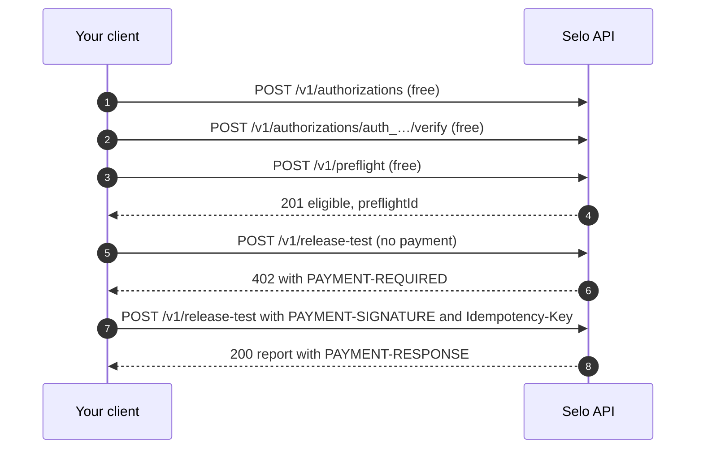

The `selo` CLI is a convenience. Selo's paid route is an ordinary x402 v2 resource on Algorand, so any x402 client that can pay an `exact` USDC requirement can run a release test. This page walks through the raw HTTP flow and shows a client built on the same x402 packages Selo uses.



## Prerequisites

- An x402 v2 client that can sign an `exact` payment on Algorand Mainnet in USDC (ASA `31566704`).
- A payer wallet opted in to USDC that holds at least 1.00 USDC per test.
- Your endpoint's URL and method, and a way to serve a file on its origin.

## Steps

<Steps>
  <Step title="Authorize the target">
    ```bash Terminal
    curl -s -X POST https://api.useselo.xyz/v1/authorizations \
      -H 'content-type: application/json' \
      -d '{"targetUrl":"https://api.example.com/v1/orders","method":"POST","project":"shop","contact":"you@example.com"}'
    ```

    Serve the returned `expectedContent` line at the returned `verificationUrl`, then verify:

    ```bash Terminal
    curl -s -X POST https://api.useselo.xyz/v1/authorizations/auth_…/verify
    ```

    The answer must show `"status": "VERIFIED"`. See [Authorize your endpoint](/guides/authorize-endpoint) for every field and error.
  </Step>
  <Step title="Run a preflight">
    ```bash Terminal
    curl -s -X POST https://api.useselo.xyz/v1/preflight \
      -H 'content-type: application/json' \
      -d '{"authorizationId":"auth_…","targetUrl":"https://api.example.com/v1/orders","method":"POST","requestBody":{"sku":"demo-widget","quantity":1}}'
    ```

    Keep `preflightId` from the `201` answer. You have 15 minutes to pay. See [Run a preflight](/guides/preflight).
  </Step>
  <Step title="Build the release test body">
    ```json release-test.json
    {
      "preflightId": "pfl_…",
      "profile": "quick",
      "expected": {
        "status": 200,
        "contentType": "application/json",
        "jsonSchema": {
          "type": "object",
          "required": ["id"],
          "properties": { "id": { "type": "string" } }
        }
      },
      "deploymentId": "<your release id>"
    }
    ```

    <ParamField body="preflightId" type="string" required>
      The eligible preflight, at most 64 characters.
    </ParamField>
    <ParamField body="profile" type="string" required>
      `quick`, the only profile.
    </ParamField>
    <ParamField body="expected" type="object">
      The release contract: optional `status`, `contentType` and `jsonSchema`. It is compiled before you are asked to pay. Without it, the paid response is only checked for status `200`. See [Write a release contract](/guides/release-contract).
    </ParamField>
    <ParamField body="deploymentId" type="string">
      The release you are testing, such as a Git SHA: 1 to 128 characters of `A-Z`, `a-z`, `0-9`, `.`, `_` or `-`. It is signed into the attestation as `asserted_by_client`.
    </ParamField>

    Unknown fields are rejected, and the request body may be at most 64 KiB.
  </Step>
  <Step title="Read Selo's 402">
    Send the body without a payment. Selo validates it, checks the preflight and its authorization, and only then answers `402` with the challenge in the `PAYMENT-REQUIRED` header, base64-encoded JSON:

    ```bash Terminal
    curl -s -D - -o /dev/null -X POST https://api.useselo.xyz/v1/release-test \
      -H 'content-type: application/json' -d @release-test.json \
      | grep -i '^payment-required:' | cut -d' ' -f2 | tr -d '\r' | base64 -d
    ```

    This is Selo's live challenge as captured from the public API, without its `extensions` (`bazaar`, with the input and output schema of the route, and `x402-merchant`, with Selo's name and categories):

    ```json PAYMENT-REQUIRED (decoded)
    {
      "x402Version": 2,
      "error": "Payment required",
      "resource": {
        "url": "https://api.useselo.xyz/v1/release-test",
        "description": "Run an authorized x402 release test. Selo settles the request, pays the target endpoint, verifies payment and response behavior, and returns an evidence-backed PASS, FAIL, or INCONCLUSIVE report.",
        "mimeType": "application/json",
        "serviceName": "Selo",
        "tags": ["x402-global-challenge"],
        "iconUrl": "https://useselo.xyz/brand/selo-logo-512.png"
      },
      "accepts": [
        {
          "scheme": "exact",
          "network": "algorand:wGHE2Pwdvd7S12BL5FaOP20EGYesN73ktiC1qzkkit8=",
          "amount": "1000000",
          "asset": "31566704",
          "payTo": "N37HMJCB4BAITC2ZU7C4XW7PUMCO4T3TUASHQEL6A4EWMLOTTHOB7IOOKY",
          "maxTimeoutSeconds": 300,
          "extra": {
            "name": "USDC",
            "decimals": 6,
            "tag": "x402-global-challenge",
            "feePayer": "ZMFK2OI7ZBD2U27ISERZC4S6LKM6WMFJPZQ4MYNJDZ2VNBNMBA67RA22AA"
          }
        }
      ]
    }
    ```

    | Field | Meaning |
    | --- | --- |
    | `accepts[0].scheme` | `exact`: pay exactly `amount` |
    | `accepts[0].network` | Algorand Mainnet, as a CAIP-2 id |
    | `accepts[0].amount` | `1000000` atomic units of a 6-decimal asset, so 1.00 USDC |
    | `accepts[0].asset` | USDC, ASA `31566704` |
    | `accepts[0].payTo` | Selo's payee. Pin it and refuse any other |
    | `accepts[0].extra.feePayer` | The facilitator account that pays the transaction fee. The Algorand `exact` client builds the fee-paying group for you |
    | `accepts[0].extra.tag`, `resource.tags` | Selo's attribution to the `x402-global-challenge` |

    If the body, the preflight or the authorization is wrong, you get that error instead of a `402`, and nothing is charged. See [Errors](#errors).
  </Step>
  <Step title="Pay and send the request again">
    Sign the requirement with your x402 client and send the same body again with two extra headers:

    | Header | Value |
    | --- | --- |
    | `PAYMENT-SIGNATURE` | The x402 v2 payment payload, as your client encodes it |
    | `Idempotency-Key` | A key you choose for this logical request: 8 to 128 characters of `A-Z`, `a-z`, `0-9`, `_` or `-`. Reuse it on every retry |

    Selo verifies the payment, claims the job under your key, settles the payment and records it, and only then pays your endpoint. The answer is the report, with Selo's settlement in the `PAYMENT-RESPONSE` header.
  </Step>
</Steps>

## A client on Selo's own x402 packages

Selo pays targets, and its CLI pays Selo, with the official x402 packages: `@x402/core` for the client and `@x402/avm` for the Algorand `exact` scheme, at version 2.27.0, with `algosdk` 3.8.0 to load the wallet. This script uses the same calls. It refuses to sign anything but the payment you approved.

```bash Terminal
npm install @x402/core@2.27.0 @x402/avm@2.27.0 algosdk@3.8.0
```

```ts pay-selo.mts
import { toClientAvmSigner } from "@x402/avm";
import { ExactAvmScheme } from "@x402/avm/exact/client";
import { x402Client, x402HTTPClient } from "@x402/core/client";
import algosdk from "algosdk";

const api = "https://api.useselo.xyz";
const network = "algorand:wGHE2Pwdvd7S12BL5FaOP20EGYesN73ktiC1qzkkit8=";
const usdc = "31566704";
const expectedPayTo = "N37HMJCB4BAITC2ZU7C4XW7PUMCO4T3TUASHQEL6A4EWMLOTTHOB7IOOKY";
const maxPrice = "1000000";

const body = JSON.stringify({
  preflightId: process.env.PREFLIGHT_ID,
  profile: "quick",
  expected: { status: 200, contentType: "application/json" },
  deploymentId: process.env.RELEASE_ID,
});
const idempotencyKey = `release-${process.env.RELEASE_ID}`;

const account = algosdk.mnemonicToSecretKey(process.env.PAYER_MNEMONIC ?? "");
const signer = toClientAvmSigner(Buffer.from(account.sk).toString("base64"));
const client = new x402Client()
  .register(network, new ExactAvmScheme(signer, { algodUrl: "https://mainnet-api.algonode.cloud" }))
  .setSpendControls({
    maxAmountPerPayment: false,
    allowedAssets: [{ network, asset: usdc, maxAmountPerPayment: maxPrice }],
  });
const http = new x402HTTPClient(client);

const headers = { "content-type": "application/json", accept: "application/json" };
const url = `${api}/v1/release-test`;

const unpaid = await fetch(url, { method: "POST", headers, body, redirect: "manual" });
if (unpaid.status !== 402) {
  throw new Error(`expected 402, got ${unpaid.status}: ${await unpaid.text()}`);
}
const required = http.getPaymentRequiredResponse((name) => unpaid.headers.get(name));
const [accept] = required.accepts;
if (
  required.accepts.length !== 1 ||
  accept === undefined ||
  accept.network !== network ||
  accept.asset !== usdc ||
  accept.payTo !== expectedPayTo ||
  BigInt(accept.amount) > BigInt(maxPrice)
) {
  throw new Error("the 402 is not the payment you approved; nothing was signed");
}

const payload = await http.createPaymentPayload(required);
const paid = await fetch(url, {
  method: "POST",
  headers: {
    ...headers,
    "Idempotency-Key": idempotencyKey,
    ...http.encodePaymentSignatureHeader(payload),
  },
  body,
  redirect: "manual",
});
const settlement = paid.headers.get("PAYMENT-RESPONSE")
  ? http.getPaymentSettleResponse((name) => paid.headers.get(name))
  : null;
const result: unknown = await paid.json();
process.stdout.write(`${JSON.stringify({ status: paid.status, settlement, result }, null, 2)}\n`);
```

```bash Terminal
PREFLIGHT_ID=pfl_… RELEASE_ID=<your release id> PAYER_MNEMONIC="…" npx tsx pay-selo.mts
```

| Call | What it does |
| --- | --- |
| `toClientAvmSigner` | Builds a signer from the 64-byte Algorand secret key in base64 |
| `new ExactAvmScheme(signer, { algodUrl })` | The Algorand `exact` scheme. It builds the USDC transfer to `payTo`, with the fee payer's transaction when `extra.feePayer` is set |
| `x402Client().register(network, scheme)` | Pays only on the network you register |
| `setSpendControls` | Caps the payment for this asset at your budget inside the SDK, as Selo does when it pays a target |
| `getPaymentRequiredResponse` | Decodes `PAYMENT-REQUIRED` |
| `createPaymentPayload` | Signs the payment |
| `encodePaymentSignatureHeader` | Returns the `PAYMENT-SIGNATURE` header for an x402 v2 payload |
| `getPaymentSettleResponse` | Decodes `PAYMENT-RESPONSE`, which carries the settlement `transaction` id |

<Warning>
  Keep the mnemonic out of your code, your logs and your shell history. Send the paid request with `redirect: "manual"`, as above, so a signed payment never follows a redirect, and never retry a payment with a new `Idempotency-Key` while an earlier outcome is unknown.
</Warning>

## The response

A finished test answers `200`. This is the `fixed-v2` result from the demo merchant's Mainnet run on 26 October 2026, rebuilt from that run's published summary and attestation, with the report token replaced:

```json 200 OK
{
  "jobId": "job_51AZ2WJZ78RF1WZC316Q1K38GG",
  "verdict": "PASS",
  "target": "https://demo.useselo.xyz/v1/orders",
  "checks": [
    {
      "id": "handshake",
      "status": "PASS",
      "code": "HANDSHAKE_VALID",
      "blocking": true,
      "summary": "Target issued a valid x402 v2 challenge with a supported requirement for network algorand:wGHE2Pwdvd7S12BL5FaOP20EGYesN73ktiC1qzkkit8= and asset 31566704.",
      "evidence": ["evd_B23GQN052SFAET2QME89MVYX5G"]
    },
    {
      "id": "paid_delivery",
      "status": "PASS",
      "code": "PAID_AND_DELIVERED",
      "blocking": true,
      "summary": "Downstream payment settled and target returned 200 with transaction QEUF5D33T4YHYP3KKIY2PGCYF55XXSUYKS5GXFBAVAZ4IEZOE3ZQ.",
      "evidence": ["evd_6K2ASNC2G3JG43Q0XE0MSXJATM", "evd_PYNAQNMTD7KQJSJ0ZM6D618AK4"]
    },
    {
      "id": "response_contract",
      "status": "PASS",
      "code": "CONTRACT_MATCHED",
      "blocking": true,
      "summary": "Observed response matched the expected status 200 and content type application/json.",
      "evidence": ["evd_6K2ASNC2G3JG43Q0XE0MSXJATM", "evd_EKR9NXGB5HRGPQ4ZBN3WM914FW"]
    },
    {
      "id": "discovery_contract",
      "status": "PASS",
      "code": "DISCOVERY_CONSISTENT",
      "blocking": true,
      "summary": "Live challenge and catalog record agree on method, URL, payment terms and carry usable metadata.",
      "evidence": ["evd_TE2XZJB33D4CXHV2EMW84SS6BG"]
    },
    {
      "id": "retry_safety",
      "status": "PASS",
      "code": "PASS_REPLAY_REJECTED",
      "blocking": true,
      "summary": "Replaying the identical signed payment header was rejected with status 402.",
      "evidence": ["evd_7ZVACZFH5PNMZAQ5T82YZN7Z9R"]
    }
  ],
  "warnings": [],
  "inconclusiveReason": null,
  "money": {
    "seloInboundTxId": "EPBEZR22SZ5LYKFM7UJYCSFG5IWNA6QYZ6XHUA6KGTTDDQQ5UIJA",
    "downstreamSpendUsdc": "0.01",
    "downstreamTxIds": ["QEUF5D33T4YHYP3KKIY2PGCYF55XXSUYKS5GXFBAVAZ4IEZOE3ZQ"]
  },
  "reportUrl": "https://api.useselo.xyz/v1/reports/<private token>"
}
```

The response also carries `attestation`, the signed envelope described in [Verify a signed verdict](/guides/verify-attestation).

<ResponseField name="jobId" type="string">The release job.</ResponseField>
<ResponseField name="verdict" type="string">`PASS`, `FAIL` or `INCONCLUSIVE`.</ResponseField>
<ResponseField name="target" type="string">The tested URL.</ResponseField>
<ResponseField name="checks" type="object[]">
  One result per check: `id`, `status` (`PASS`, `WARN`, `FAIL` or `INCONCLUSIVE`), `code`, `blocking`, `summary` and the `evidence` ids. See [The five release checks](/concepts/checks).
</ResponseField>
<ResponseField name="warnings" type="string[]">Concerns that do not block, such as a WARN.</ResponseField>
<ResponseField name="inconclusiveReason" type="string | null">Why the verdict is INCONCLUSIVE, otherwise `null`.</ResponseField>
<ResponseField name="money" type="object">
  `seloInboundTxId`, the transaction in which you paid Selo; `downstreamSpendUsdc`, what Selo spent on the target; `downstreamTxIds`, the transactions in which Selo paid it.
</ResponseField>
<ResponseField name="reportUrl" type="string">The private report link. Anyone who has it can read the report, so keep it secret.</ResponseField>
<ResponseField name="attestation" type="object">The Ed25519-signed attestation, when Selo has a signing key.</ResponseField>

Recompute the verdict from `checks` before you trust it: any blocking FAIL with evidence is FAIL; otherwise any blocking INCONCLUSIVE, missing check or check without evidence is INCONCLUSIVE; otherwise PASS. That is what the CLI does. See [Verdicts and the gate](/concepts/verdicts).

## Retries

Send every retry of the same logical request with the **same** `Idempotency-Key` and the same `preflightId`. Selo's 402 still asks for a payment on a retry, so your client signs one, but Selo uses the key to find the existing job and never settles the new payment:

| The existing job | Selo answers |
| --- | --- |
| Has a report | `200` with the same report |
| Is still running | `409 JOB_IN_PROGRESS`. Retry later |
| Ended without a report | `409 JOB_TERMINAL`. Start a new preflight to test again |
| Has a held inbound settlement | `502 INBOUND_SETTLEMENT_UNRESOLVED`. Do not pay again |

Retries work while the preflight is valid. After 15 minutes the route answers `409 PREFLIGHT_EXPIRED` before it looks for the job. If you send no `Idempotency-Key`, Selo derives the key from the payment payload itself, so only the identical signed payment is recognized as the same request, and a newly signed retry would be a new paid test.

## Errors

The route checks in this order, and everything before the settlement is free:

| HTTP | Code | When | Charged |
| --- | --- | --- | --- |
| 413 | `PAYLOAD_TOO_LARGE` | The body is over 64 KiB | No |
| 400 | `VALIDATION_FAILED` | Invalid JSON, an unknown field, a malformed `Idempotency-Key` or `deploymentId`, or an `expected` contract that does not compile | No |
| 404 | `PREFLIGHT_NOT_FOUND` | The preflight id does not exist | No |
| 422 | `PREFLIGHT_INELIGIBLE` | The preflight was not eligible | No |
| 409 | `PREFLIGHT_EXPIRED` | The preflight is older than 15 minutes | No |
| 403 | `AUTHORIZATION_INVALID` | The authorization is no longer verified | No |
| 422 | `PRICE_OVER_BUDGET` | The target's price is above the job budget | No |
| 402 | (challenge) | No payment, an invalid payment, or a settlement the facilitator definitely rejected. You may pay again | No |
| 502 | `FACILITATOR_UNAVAILABLE` | The facilitator could not verify the payment | No |
| 502 | `INBOUND_SETTLEMENT_UNRESOLVED` | The facilitator did not confirm the settlement. The job is held for reconciliation and never runs. The body carries `jobId` and `txId` | Possibly. Do not pay again |
| 500 | `INBOUND_RECORD_FAILED` | Your payment settled but Selo could not record it. The job does not run and is flagged for reconciliation | Yes |
| 500 | `INTERNAL` | An unexpected error. After a settlement, the body carries the `jobId` and says Selo failed after settling your payment, and the job is recorded as INCONCLUSIVE or flagged for reconciliation | Only when the body says so |
| 409 | `JOB_IN_PROGRESS`, `JOB_TERMINAL` | A retry of an existing job, as above | No new charge |

See [Held payments and reconciliation](/concepts/reconciliation) for what Selo does with a held settlement, and [Errors and reason codes](/api-reference/errors) for every code.

## Next

<CardGroup cols={2}>
  <Card title="API overview" icon="code" href="/api-reference/introduction">
    Every route, request and response.
  </Card>
  <Card title="Run a release test" icon="flask" href="/guides/run-release-test">
    The CLI does all of this, plus recovery and exit codes.
  </Card>
</CardGroup>
