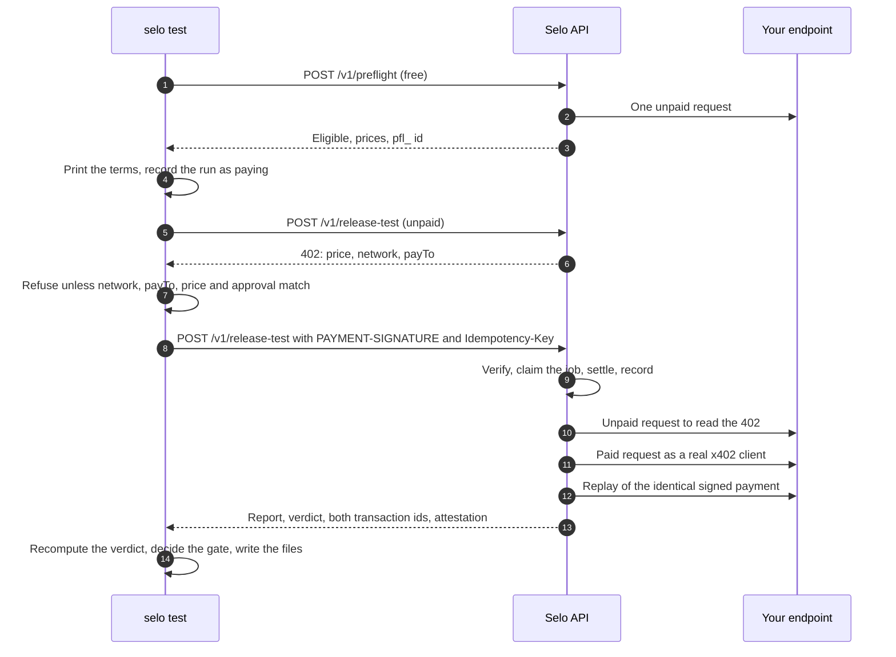

`selo test` is the release gate. It runs a free preflight, shows every price, pays Selo once with a dedicated wallet, waits while Selo pays your endpoint and runs the five release checks, then exits `0` only for a fully evidenced PASS.

<Warning>
  A release test makes real payments on Algorand Mainnet. You pay Selo 1.00 USDC. Selo then sends **one paid request** to your endpoint and **one replay** of the identical signed payment and body. If the paid route has side effects, test a staging route or a test SKU.
</Warning>

## Prerequisites

- A checkout of the Selo repository, Node 24 and pnpm 10, with `pnpm install --frozen-lockfile`. See [CLI overview](/cli/overview).
- A verified authorization for the exact URL and method. See [Authorize your endpoint](/guides/authorize-endpoint).
- A release contract file. See [Write a release contract](/guides/release-contract).
- For `POST`, the JSON request body file. See [Run a preflight](/guides/preflight).
- A dedicated payer wallet: an Algorand account opted in to USDC (ASA `31566704`) that holds at least 1.00 USDC per run. Keep only what a few tests cost in it.
- Selo's payee address, the `payTo` in Selo's 402. On the public API it is `N37HMJCB4BAITC2ZU7C4XW7PUMCO4T3TUASHQEL6A4EWMLOTTHOB7IOOKY`. The CLI prints the `payTo` it finds before signing and refuses to pay any other address than the one you pass.

## What one run does



The CLI signs exactly one payment, the one Selo's 402 asks for, and sends it once. It never retries a payment on its own.

## Run it

<Steps>
  <Step title="Provide the payer wallet">
    The CLI reads the payer's 25-word mnemonic from `SELO_PAYER_MNEMONIC` only. It never prints it or writes it to a file.

    ```bash Terminal
    read -rs SELO_PAYER_MNEMONIC && export SELO_PAYER_MNEMONIC
    ```

    `read -rs` keeps the words out of your shell history and off the screen.
  </Step>
  <Step title="Run the test">
    ```bash Terminal
    pnpm selo test \
      --api https://api.useselo.xyz \
      --authorization auth_… \
      --url https://api.example.com/v1/orders --method POST \
      --body body.json --contract contract.json \
      --release "$(git rev-parse HEAD)" \
      --network mainnet --max-usdc 1.00 \
      --approve-mainnet --pay-to N37HMJCB4BAITC2ZU7C4XW7PUMCO4T3TUASHQEL6A4EWMLOTTHOB7IOOKY \
      --summary selo-gate.json --attestation selo-attestation.json
    ```

    The paid request is a single long call: Selo answers only after your payment has settled, it has paid your endpoint and the checks have run. The CLI waits up to 5 minutes for each answer.
  </Step>
  <Step title="Read the verdict and the exit code">
    ```bash Terminal
    echo $?
    ```

    `0` means ship. Anything else blocks. See [Exit codes](#exit-codes).
  </Step>
</Steps>

## Flags

| Flag | Required | Meaning |
| --- | --- | --- |
| `--api` | yes | Selo's API base URL. `https` only, except `http` for `localhost` |
| `--authorization` | yes | The verified `auth_…` id |
| `--url` | yes | The `https` URL of your paid route |
| `--method` | yes | `GET` or `POST` |
| `--body` | no | JSON request body file, `POST` only. At most 64 KiB on disk and 16 KiB once sent |
| `--contract` | yes | The release contract file. It is compiled before anything is sent |
| `--release` | yes | The build you are testing, such as a Git SHA: 1 to 128 characters of `A-Z`, `a-z`, `0-9`, `.`, `_` or `-`. Selo does not verify it; it is recorded as asserted by you, and it names the local run state |
| `--network` | yes | `mainnet` or `testnet`. The network in Selo's 402 must match |
| `--max-usdc` | yes | The most this run may pay Selo, such as `1.00`. A higher price is refused before signing |
| `--pay-to` | on Mainnet | Selo's expected payee address. A 402 that names another `payTo` is refused before signing |
| `--approve-mainnet` | on Mainnet | Your explicit approval of a Mainnet payment |
| `--summary` | no | Where to write the sanitized `selo.gate.v1` summary |
| `--attestation` | no | Where to save Selo's signed attestation |
| `--resume` | no | Fetch the result of an earlier run whose outcome is unconfirmed, without paying again. See [Recover an interrupted run](/guides/resume) |

Relative paths resolve from the directory you ran `pnpm selo` in. Unknown flags are rejected. Run `pnpm selo --help` for the built-in usage.

## Reading the terminal output

This is the output `selo test` prints, filled in with the values of the `fixed-v2` run against the demo merchant on 26 October 2026, taken from that run's published summary. Values that run did not publish, and that will be your own, are in angle brackets.

```text Output
release     fixed-v2 (asserted by you, not verified by Selo)
target      POST https://demo.useselo.xyz/v1/orders
preflight   pfl_…, valid until <ISO 8601 time>
target fee  0.01 USDC, paid by Selo from its own wallet
Selo cap    0.01 USDC at most spent on the target
you pay     1.00 USDC to Selo on algorand-mainnet
budget      1.00 USDC approved for this run
payer       <your payer address>
price    1.00 USDC (asset 31566704)
network  algorand:wGHE2Pwdvd7S12BL5FaOP20EGYesN73ktiC1qzkkit8=
payTo    N37HMJCB4BAITC2ZU7C4XW7PUMCO4T3TUASHQEL6A4EWMLOTTHOB7IOOKY
payer    <your payer address>
tag      x402-global-challenge
status   200
inbound  EPBEZR22SZ5LYKFM7UJYCSFG5IWNA6QYZ6XHUA6KGTTDDQQ5UIJA
verdict     PASS
check       handshake           PASS          HANDSHAKE_VALID
check       paid_delivery       PASS          PAID_AND_DELIVERED
check       response_contract   PASS          CONTRACT_MATCHED
check       discovery_contract  PASS          DISCOVERY_CONSISTENT
check       retry_safety        PASS          PASS_REPLAY_REJECTED
job         job_51AZ2WJZ78RF1WZC316Q1K38GG
inbound     EPBEZR22SZ5LYKFM7UJYCSFG5IWNA6QYZ6XHUA6KGTTDDQQ5UIJA
downstream  QEUF5D33T4YHYP3KKIY2PGCYF55XXSUYKS5GXFBAVAZ4IEZOE3ZQ
report      https://api.useselo.xyz/v1/reports/<private> (private link saved in <your directory>/.selo/runs/fixed-v2.json)
gate        ALLOW (exit 0): PASS on every release check
attestation <your directory>/selo-attestation.json (signed by selo-ed25519-728fcf85650b128f)
```

The output comes in four blocks.

| Block | Lines | What they tell you |
| --- | --- | --- |
| Terms, from the preflight | `release` to `payer` | What you are testing, what Selo will pay your endpoint, what you will pay Selo, and your budget. Printed before anything is signed |
| Selo's 402 | `price`, `network`, `payTo`, `payer`, `tag` | The exact payment the CLI is about to sign |
| Your payment | `status`, `inbound` | Selo's HTTP status and the settlement transaction of your payment, read from the `PAYMENT-RESPONSE` header |
| The result | `verdict` to `attestation` | The verdict, each check as `id`, status and code, any `warning` lines, the job id, both transaction ids, the redacted report link, and the gate decision |

`inbound` is the transaction in which you paid Selo. `downstream` is the transaction in which Selo paid your endpoint. Look either up at `https://allo.info/tx/<txId>`.

For the `broken-v1` run, the result lines read:

```text Output
verdict     FAIL
check       handshake           PASS          HANDSHAKE_VALID
check       paid_delivery       PASS          PAID_AND_DELIVERED
check       response_contract   FAIL          SCHEMA_MISMATCH
check       discovery_contract  INCONCLUSIVE  CATALOG_UNAVAILABLE
check       retry_safety        PASS          PASS_REPLAY_REJECTED
job         job_189NZ481HFH77CRGF60AEF22RG
inbound     SVGTX3U6XQLSGJP7L7X7KNPSDLWFBSA3JK7AFNHPWENIWP4YVIEQ
downstream  RZR6XUIA3GTHW6ABAHUIXRDCNYYXIHQVQYGN2T5PAMDO37DDDOLQ
report      https://api.useselo.xyz/v1/reports/<private> (private link saved in <your directory>/.selo/runs/broken-v1.json)
gate        BLOCK (exit 1): FAIL: response_contract
```

A proven FAIL decides the verdict even though `discovery_contract` could not be proven in that run. See [Verdicts and the gate](/concepts/verdicts).

## Exit codes

| Exit | Gate | When |
| --- | --- | --- |
| `0` | ALLOW | The verdict is PASS, it follows from the report's own checks, all five checks are present with evidence, and the report carries the inbound transaction, a downstream transaction and a report link |
| `1` | BLOCK | FAIL proven by a release check |
| `2` | BLOCK | INCONCLUSIVE, an unconfirmed payment, a missing or inconsistent report, a transient failure, or an unexpected error |
| `3` | BLOCK | Refused before paying: invalid input, missing authorization, ineligible preflight, or a payment you did not approve |

The CLI does not trust the verdict label. It recomputes the verdict from the report's checks with the same pure reducer Selo uses. If they disagree, or a PASS lacks a check, evidence or a transaction, it blocks with exit `2`. A WARN, such as a route not yet listed in Bazaar, appears as a `warning` line and does not block a PASS.

## Files the run writes

| File | Written when | Safe to share | Contents |
| --- | --- | --- | --- |
| `--summary <file>` | Every run that gets past the preflight, whatever its outcome | Yes | The `selo.gate.v1` summary: release, target, network, gate, exit code, reason, verdict, checks, warnings, transaction ids, job id, and the report link with its token replaced by `<private>` |
| `--attestation <file>` | When Selo's answer carries an attestation | Yes | Selo's Ed25519-signed attestation. If there is none, the CLI prints `attestation none: Selo issued no signed attestation for this run` instead |
| `$GITHUB_STEP_SUMMARY` | When the variable is set, at the same point as the summary | Yes | The same summary as a Markdown table, appended |
| `.selo/runs/<release>.json` | Before the paid request is sent, and again with the outcome | **No** | The run state, including the full private report link. Mode `600`. Never commit or upload it |

The summary of the `fixed-v2` run, as published:

```json selo-gate.json
{
  "schema": "selo.gate.v1",
  "release": { "id": "fixed-v2", "verification": "asserted_by_client" },
  "target": { "url": "https://demo.useselo.xyz/v1/orders", "method": "POST" },
  "network": "algorand-mainnet",
  "gate": "ALLOW",
  "exitCode": 0,
  "reason": "PASS on every release check",
  "verdict": "PASS",
  "inconclusiveReason": null,
  "checks": [
    { "id": "handshake", "status": "PASS", "code": "HANDSHAKE_VALID", "summary": "Target issued a valid x402 v2 challenge with a supported requirement for network algorand:wGHE2Pwdvd7S12BL5FaOP20EGYesN73ktiC1qzkkit8= and asset 31566704." },
    { "id": "paid_delivery", "status": "PASS", "code": "PAID_AND_DELIVERED", "summary": "Downstream payment settled and target returned 200 with transaction QEUF5D33T4YHYP3KKIY2PGCYF55XXSUYKS5GXFBAVAZ4IEZOE3ZQ." },
    { "id": "response_contract", "status": "PASS", "code": "CONTRACT_MATCHED", "summary": "Observed response matched the expected status 200 and content type application/json." },
    { "id": "discovery_contract", "status": "PASS", "code": "DISCOVERY_CONSISTENT", "summary": "Live challenge and catalog record agree on method, URL, payment terms and carry usable metadata." },
    { "id": "retry_safety", "status": "PASS", "code": "PASS_REPLAY_REJECTED", "summary": "Replaying the identical signed payment header was rejected with status 402." }
  ],
  "warnings": [],
  "money": {
    "seloInboundTxId": "EPBEZR22SZ5LYKFM7UJYCSFG5IWNA6QYZ6XHUA6KGTTDDQQ5UIJA",
    "downstreamTxIds": ["QEUF5D33T4YHYP3KKIY2PGCYF55XXSUYKS5GXFBAVAZ4IEZOE3ZQ"],
    "downstreamSpendUsdc": "0.01"
  },
  "jobId": "job_51AZ2WJZ78RF1WZC316Q1K38GG",
  "report": "https://api.useselo.xyz/v1/reports/<private>",
  "decidedAt": "2026-10-26T10:24:14.275Z"
}
```

<Tip>
  Add `.selo/` to your `.gitignore`. See [Output files](/cli/files) for every field of each file.
</Tip>

## The private report

The terminal and the summary redact the report token. The full link is kept only in the run state file, as `reportUrl`. It opens Selo's full report: the observed response's hash and size, every payment with its expected and actual transaction id, and every scenario with its operation id, attempts and duration.

```bash Terminal
curl -s "$(node -p 'require("./.selo/runs/fixed-v2.json").reportUrl')"
```

Anyone who has the link can read the report. Selo serves it with `X-Robots-Tag: noindex, nofollow`, `Cache-Control: private, no-store` and `Referrer-Policy: no-referrer`. To share a result, share the attestation instead: it holds no secret and anyone can [verify it](/guides/verify-attestation).

## Spending and approval

| | Who pays | Limit |
| --- | --- | --- |
| The release test | You pay Selo, once | Selo's price, 1.00 USDC. `--max-usdc` caps it; the CLI also refuses any price above 5.00 USDC |
| Your endpoint's price | Selo pays it from its own wallet | At most 0.50 USDC per job. Shown as `target fee` and `Selo cap` |

Before it signs, the CLI refuses when:

- the 402 asks for another network than `--network`;
- the 402 does not offer exactly one `exact` USDC requirement on Algorand;
- the price is zero, above 5.00 USDC, or above `--max-usdc`;
- the `payTo` differs from `--pay-to`, or equals your own payer address;
- the payment is on Mainnet and `--approve-mainnet` or `--pay-to` is missing.

Each refusal exits `3` with nothing signed. The paid request carries an `Idempotency-Key` derived from the preflight and your payer address, so Selo never settles the same request twice.

## Testnet

`--network testnet` exists for a Selo deployment that runs on Algorand Testnet, where USDC is ASA `10458941`. Point `--api` at that deployment; `http://localhost` is accepted for a local one.

The public API at `https://api.useselo.xyz` runs on Mainnet. Against it, `--network testnet` is refused before signing:

```text Output
refusing: the 402 asks for payment on algorand-mainnet, not the expected algorand-testnet
```

To run Selo itself, see "Running it yourself" in the [repository README](https://github.com/Enoch208/selo#running-it-yourself).

## Troubleshooting

| Message | Exit | Cause | What to do |
| --- | --- | --- | --- |
| `--network mainnet needs --approve-mainnet and --pay-to <Selo's payTo address>` | 3 | A Mainnet run without both flags | Add both, after checking the payee |
| `SELO_PAYER_MNEMONIC is not set: export the dedicated, capped payer wallet` | 3 | No wallet in the environment | Export the variable |
| `SELO_PAYER_MNEMONIC is not a valid Algorand mnemonic` | 3 | The words do not form an Algorand account | Check the 25 words |
| `the contract file … is not usable: …` | 3 | The contract does not compile | See [Write a release contract](/guides/release-contract) |
| `--body is only allowed with --method POST` | 3 | A body on a `GET` | Remove `--body` |
| `preflight ineligible (<REASON>), nothing was paid: …` | 3 | The target is not testable | See [rejection reasons](/guides/preflight#rejection-reasons) |
| `preflight refused, nothing was paid: HTTP 4xx …` | 3 | Selo rejected the preflight request | Read the error code in the message |
| `preflight unavailable, nothing was paid: …` | 2 | Selo answered `5xx` or could not be reached | Try again later |
| `refusing: the 402 asks for payment on <network>, not the expected <network>` | 3 | `--network` does not match Selo's network | Use the network Selo runs on |
| `refusing: the price … USDC is above the approved budget of … USDC` | 3 | Selo's price is above `--max-usdc` | Check the price, then raise `--max-usdc` deliberately |
| `refusing: the 402 names payTo …, not the expected …` | 3 | `--pay-to` does not match Selo's 402 | Confirm Selo's payee and fix `--pay-to` |
| `refusing: the payer is the payTo address (self-payment)` | 3 | You are paying from Selo's own payee address | Use a separate payer wallet |
| `Selo did not accept the payment, nothing was charged: HTTP 402 …` | 3 | The payment did not verify, often because the payer lacks USDC or is not opted in to it | Fund the payer and opt it in, then run again |
| `the facilitator could not verify the payment, nothing was charged: …` | 2 | The facilitator was unavailable during verification | Run again later |
| `expected a 402 with PAYMENT-REQUIRED, got HTTP <status>: …` | 3, or 2 for a `5xx` | Selo refused the unpaid request; the body in the message names the code, such as `PREFLIGHT_EXPIRED` or `AUTHORIZATION_INVALID` | Fix the cause the code names and run again; each run takes a fresh preflight |
| `Selo refused the release test: HTTP 4xx …` | 3 | Selo rejected the paid request with a client error other than `402` | Read the error code in the message |
| `the payment outcome is not confirmed; do not pay again blindly: …` | 2 | Selo answered `5xx`, for example a held settlement, after your payment was sent | Do not start a new run. See [Recover an interrupted run](/guides/resume) |
| `release <id> has an unconfirmed paid run (…)` | 2 | An earlier run for this release is unconfirmed | Rerun the same command with `--resume` |
| `the run state … is unreadable; inspect it before paying again` | 2 | `.selo/runs/<release>.json` is not a valid run state | Inspect the file before you do anything else |
| `INCONCLUSIVE: <reason>` | 2 | Selo could not prove the result, for example `FACILITATOR_UNAVAILABLE` when the Bazaar catalog could not be read | Fix the cause or retry later. INCONCLUSIVE is never a PASS |
| `the reported verdict … does not follow from its checks (…)` | 2 | The report is inconsistent | Do not ship; keep the summary and investigate |
| `PASS is not fully evidenced: …` | 2 | A PASS lacks a check, a transaction or the report link | Do not ship |

## Next

<CardGroup cols={2}>
  <Card title="Gate deploys in GitHub Actions" icon="github" href="/guides/github-actions">
    Run the same gate in CI behind a protected environment.
  </Card>
  <Card title="Verify a signed verdict" icon="certificate" href="/guides/verify-attestation">
    Check the attestation offline before you promote.
  </Card>
</CardGroup>
