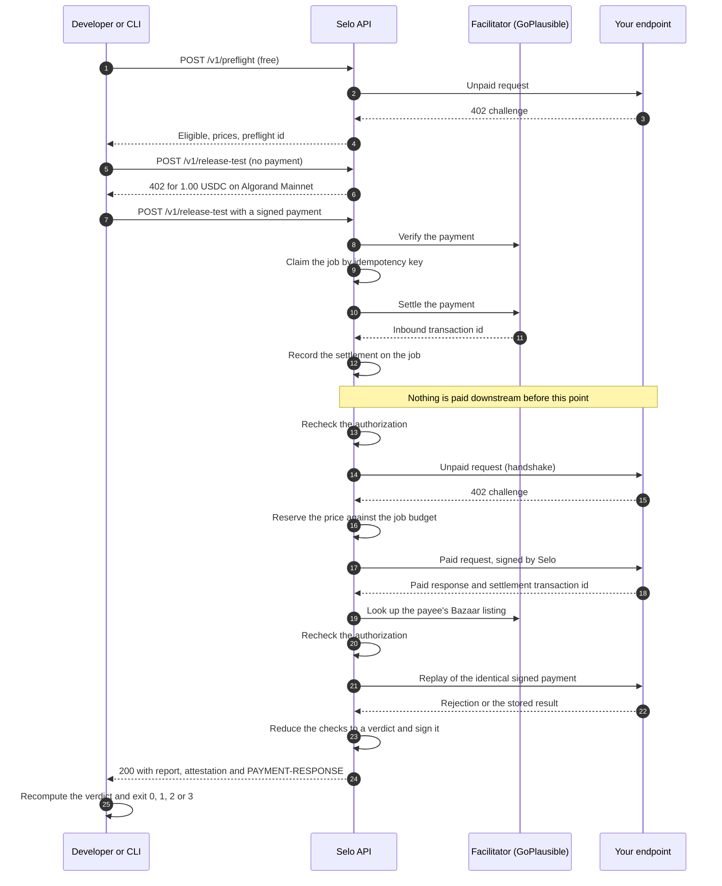

A release test is one paid request to Selo that turns into one paid request to your endpoint. Selo is paid first, records that payment, and only then pays your endpoint as a real x402 client, checks what comes back, and returns a verdict backed by both transactions.

## The flow



Before any of this, the owner of the endpoint [authorizes](/concepts/authorization) the exact origin, route and method by serving a one-time line at `/.well-known/selo-verification.txt`. Every request that can pay or cause a side effect checks that authorization again.

## Two payment legs

Every release test has two payments, both in USDC (ASA `31566704`) on Algorand Mainnet. Both appear in the report and in the signed attestation.

| Leg            | From                          | To                       | Amount                                       | Where you find it                                   |
| -------------- | ----------------------------- | ------------------------ | -------------------------------------------- | --------------------------------------------------- |
| **Inbound**    | Your payer wallet             | Selo's payTo             | 1.00 USDC, Selo's price                      | `money.seloInboundTxId` in the report               |
| **Downstream** | Selo's operating wallet       | Your endpoint's payTo    | Your endpoint's price, at most 0.50 USDC     | `money.downstreamTxIds` in the report               |

You pay only the inbound leg. Selo pays the downstream leg from its own wallet. When Selo signs the downstream payment, the requirement must match what it reserved: network, asset, amount and payee. It signs exactly the requirement your `402` offered and nothing more. See [Payments and spend limits](/concepts/payments).

## Why Selo settles before it runs

Selo never spends before it has been paid. The paid route composes the steps explicitly, in this order: validate the request, answer `402`, verify the payment, claim the job by idempotency key, settle, record the inbound transaction on the job, then run.

This order matters for two reasons:

- **Selo cannot be made to spend for free.** If Selo paid your endpoint before its own payment settled, a payment that never lands would still cost Selo the downstream price. The runner refuses any job whose inbound settlement is not recorded, and a test (`A12`) checks the database timestamps and the call order.
- **The stock middleware settles too late.** The stock x402 middleware for Hono settles after the handler runs. That order cannot support a service that pays someone else inside the handler, so Selo does not use it on the paid route.

If the settlement outcome is unknown (a facilitator timeout, a 5xx, a pending result that still carries a transaction), Selo **holds** the job instead of discarding it. It answers `502 INBOUND_SETTLEMENT_UNRESOLVED`, tells the client not to pay again, never runs the job, and keeps the transaction id for reconciliation. A duplicate request with the same idempotency key is answered from the existing job and never settles again. See [Held payments and reconciliation](/concepts/reconciliation).

## What your endpoint sees

Selo calls only the exact HTTPS URL and method you authorized. Every preflight and test request to your route carries an `Idempotency-Key` header with a stable operation id.

| When                     | Request                                                                                    | Paid |
| ------------------------ | ------------------------------------------------------------------------------------------ | ---- |
| `selo auth verify`       | `GET /.well-known/selo-verification.txt` on your origin                                   | No   |
| Preflight                | One unpaid request with your method and body, to read the `402`                            | No   |
| Release test, handshake  | One unpaid request to read the `402`                                                       | No   |
| Release test, paid       | One paid request, signed by Selo, with your method and body                                | Yes  |
| Release test, replay     | One replay of the identical signed payment and body, with the same `Idempotency-Key`       | Already paid |

`selo test` runs its own preflight on every run, so one `selo test` sends two unpaid requests, one paid request and one replay. Selo also reads your payee's listing from the Bazaar catalog, which is a request to the facilitator, not to your endpoint.

<Warning>
  The replay re-sends the exact payment your endpoint has already settled. A correct endpoint rejects it or returns its stored result without a second settlement. If your paid route has side effects, test a staging route or a test SKU.
</Warning>

## The five checks

The checks run in this order. If the handshake does not pass, Selo stops there and pays nothing downstream.

| Order | Check id             | Name               | PASS means                                                                                                             | What fails it                                                                          |
| ----- | -------------------- | ------------------ | ---------------------------------------------------------------------------------------------------------------------- | -------------------------------------------------------------------------------------- |
| 1     | `handshake`          | Handshake          | The unpaid request returns a valid x402 v2 `402` with an Algorand USDC requirement, a valid payTo and a parseable price | Not a `402`, a missing or malformed challenge, no supported requirement, an invalid payTo |
| 2     | `paid_delivery`      | Paid delivery      | Selo's payment settled, the settlement id matches the transaction Selo signed, and the paid resource came back         | Paid but not delivered, or a valid payment rejected by the target                      |
| 3     | `response_contract`  | Response contract  | The expected status, content type and optional JSON Schema all match the paid response                                 | Any mismatch, or a non-JSON body when a schema is expected                             |
| 4     | `discovery_contract` | Discovery contract | The live `402` and the payee's Bazaar listing agree on method, URL, payment terms and price                            | The payee's listing names another price, asset or network                              |
| 5     | `retry_safety`       | Retry safety       | Replaying the identical signed payment is rejected, or returns the stored result without a second settlement           | The replay produces a second paid side effect                                          |

Each check ends in `PASS`, `WARN`, `FAIL` or `INCONCLUSIVE` with a code and the ids of the evidence that backs it. The response contract is evaluated from the paid response, so it sends no request of its own. Every code is listed in [The five release checks](/concepts/checks).

## The verdict

The verdict is a pure function of the check results, in `packages/core/src/verdict.ts`. No model is involved.

```text
any blocking check FAIL with evidence                         →  FAIL
otherwise: a blocking INCONCLUSIVE, a missing check,
           a check without evidence, or a stopped run         →  INCONCLUSIVE
otherwise                                                     →  PASS
```

**Unknown is never PASS.** A network outage, a facilitator timeout, a payment whose outcome is unclear, Selo's own wallet running low, or an authorization that lapsed mid-run all end in INCONCLUSIVE with a reason. A failure on Selo's side is never reported as a failure of your endpoint. A `WARN` with evidence is listed under `warnings` and does not change the verdict. See [Verdicts and the gate](/concepts/verdicts).

## The signed attestation

When the run ends, Selo signs an attestation of the result with its Ed25519 key and returns it with the report. The payload (`selo.release.v1`) records the job, the tested URL and method, the release id you asserted, the verdict, every check with its evidence ids, both payment legs, a SHA-256 of your release contract and of your `402`, and a manifest of the evidence with its hashes. It carries no secret, request body or report token.

Anyone can verify it offline against the keys at `https://api.useselo.xyz/.well-known/selo-attestation-keys.json`. See [Signed attestations](/concepts/attestations).

## The report

The response to `POST /v1/release-test` carries the job id, the verdict, every check, any warnings, the inconclusive reason, both transaction ids, the downstream spend and a private report link. The full report at that link adds the observed response (status, content type, body hash and size), every payment with its status, and each scenario with its operation id, attempts and duration. The link is an unguessable token, served with `noindex`, `no-store` and `no-referrer`.

## Where the gate decision happens

Selo computes the verdict on the server. The decision to ship is made on your side:

1. **The `selo` CLI** does not trust the verdict label. It recomputes the verdict from the report's own checks with the same reducer Selo uses. It then requires a result for all five checks, an inbound transaction, a downstream transaction and a report link. Only then does it print `gate ALLOW` and exit `0`. A disagreement or a gap blocks with exit `2`.
2. **In GitHub Actions**, the paid job runs the CLI and the promote job runs only when the gate is `ALLOW`. Before promoting, it verifies the signed attestation against a key you pinned, for the exact commit, URL and method. A PASS for one commit cannot unlock another.

See [Gate deploys in GitHub Actions](/guides/github-actions) and the [CLI exit codes](/cli/overview).

## Next steps

<CardGroup cols={2}>
  <Card title="Run your first release test" icon="rocket" href="/quickstart">
    Authorize, preflight and pay, step by step.
  </Card>
  <Card title="Security model" icon="shield-halved" href="/concepts/security">
    Authorization, SSRF rules, spend limits and secret handling.
  </Card>
</CardGroup>
